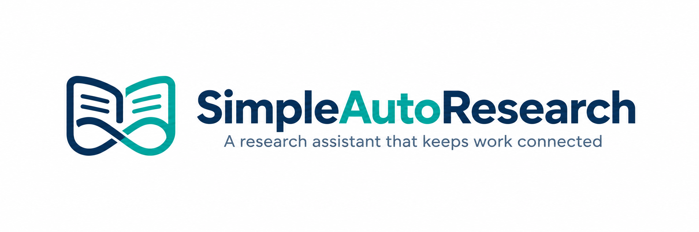
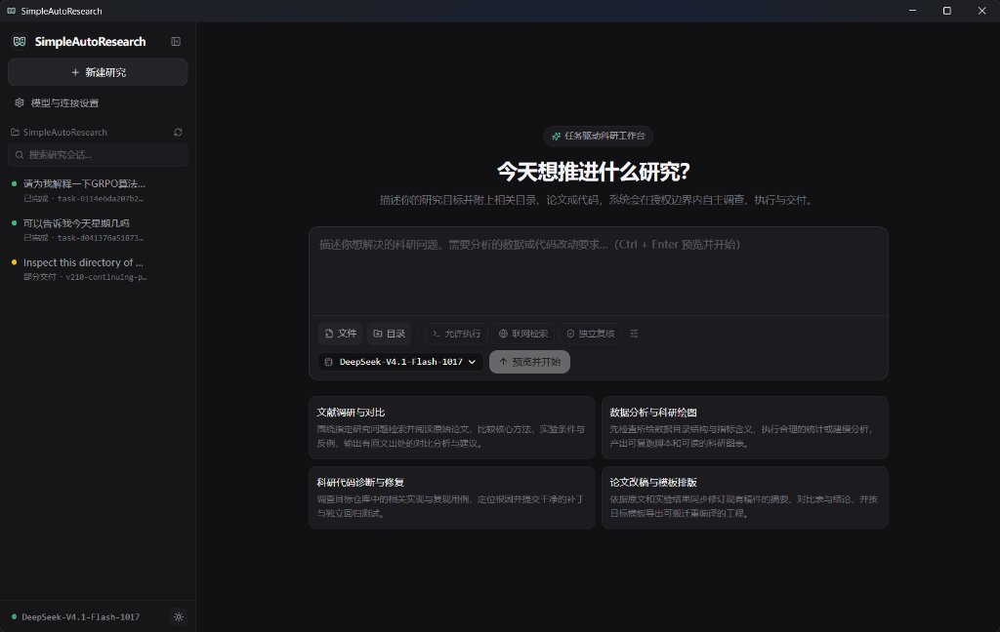
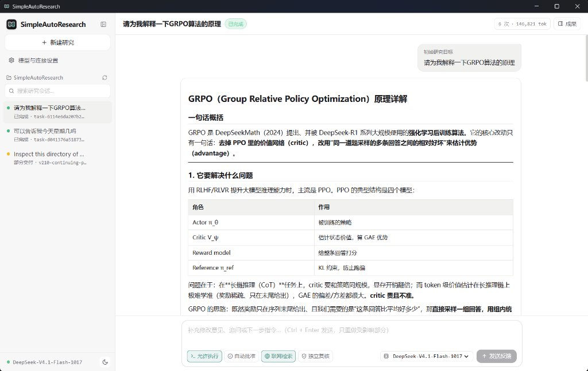
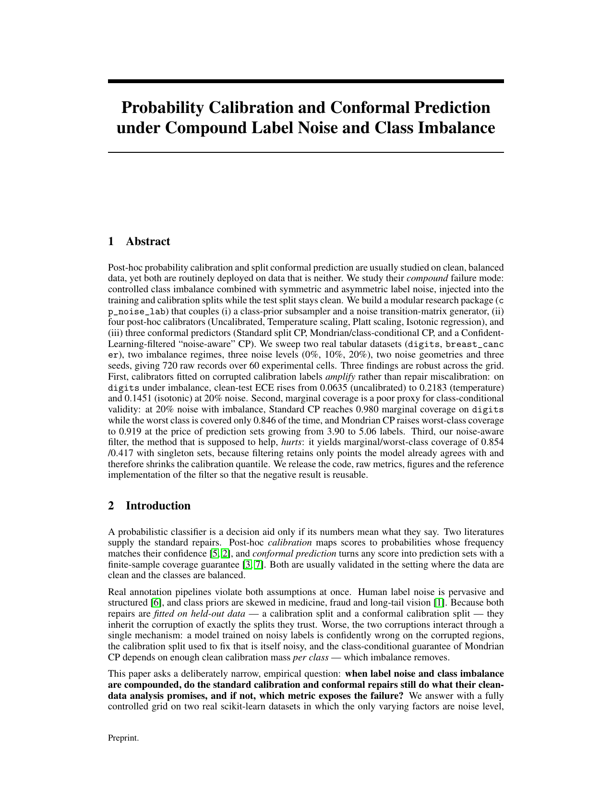
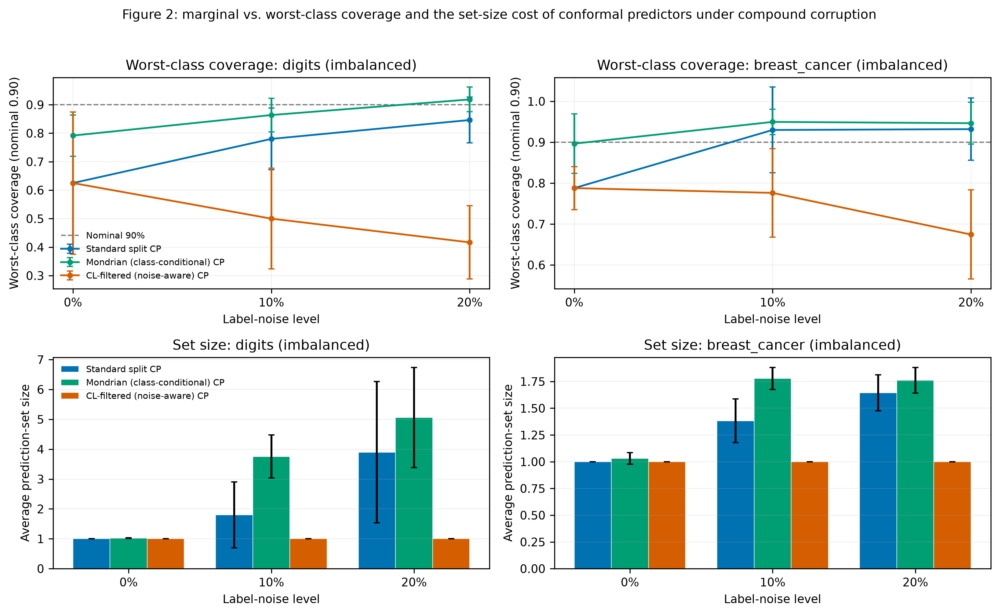
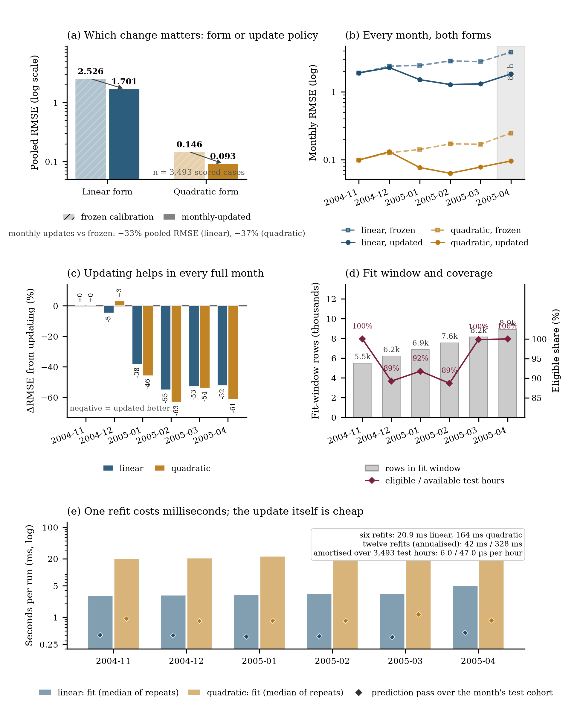
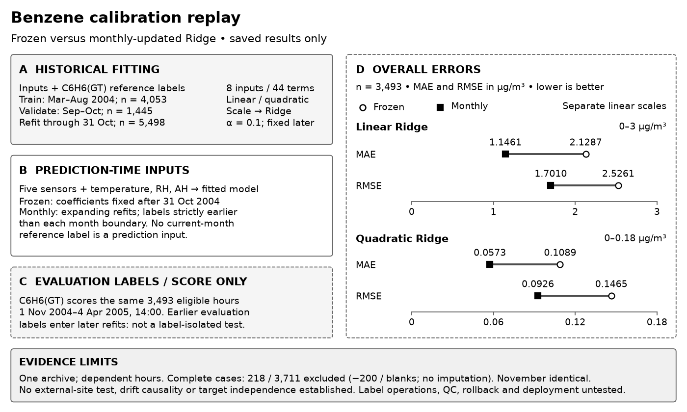

<p align="center">
  
</p>

<h1 align="center">SimpleAutoResearch</h1>

<p align="center">
  <strong>A local-first, evidence-grounded continuing research assistant: literature search, experiment code, figures, independent review and LaTeX publication in one resumable workspace.</strong>
</p>

<p align="center">
  
  
  
  
</p>

<p align="center">
  <a href="README_zh.md">中文</a> ·
  <a href="#desktop-research-workbench">Desktop Workbench</a> ·
  <a href="#real-delivered-work">Showcase</a> ·
  <a href="#3-minute-quick-start">Quick Start</a> ·
  <a href="docs/README.md">Documentation</a> ·
  <a href="CHANGELOG.md">Changelog</a>
</p>

---

Real research is rarely a one-shot pipeline: papers shape hypotheses, code produces measurements, plots surface surprises, independent checks catch discrepancies, and human feedback redirects the next step. **SimpleAutoResearch** keeps this entire lifecycle inside one inspectable, pausable, and reusable local task ledger—you control the research question, permissions and scientific judgment while the assistant investigates, executes, checks and delivers editable artifacts within your boundaries.

---

## Desktop Research Workbench

SimpleAutoResearch ships with a native desktop workbench (`simple-ar-desktop`, built with React + Tailwind + KaTeX inside `pywebview`) that shares the exact same task ledger and `models.toml` catalog as the CLI—complete with dark/light themes, automatic run on creation, execution approval, one-click inline budget continuation after pauses, session search, and live previews for Markdown, math formulas, figures and paginated PDFs.

<table>
  <tr>
    <td width="50%">
      
      <p align="center"><sub>Dark mode · New research composer, source mounts, permission toggles & task templates</sub></p>
    </td>
    <td width="50%">
      
      <p align="center"><sub>Light mode · Structured replies, real-time ledger counter & inline feedback bar</sub></p>
    </td>
  </tr>
</table>

---

## What Makes It Different

| Pillar | What you actually get |
|---|---|
| **Continuing Projects & Cross-Task Reuse** | Pause safely at work boundaries and resume on the original ledger; iterate via `--resume-task`, transfer delivered code & `SKILL.md` methodology to new datasets via `--from-session ... --reuse artifacts`, recover from disconnects via `--retry-model`, and extend exhausted budgets via `--authorize-remaining`. |
| **Independent Review & Honest Delivery** | An independent reviewer cross-checks original data, code and prose claims; contradictions trigger revision, and when budget or capability limits prevent full sign-off, the task honestly delivers `partial` with explicit `unresolved` items—**never faking `completed`**. |
| **End-to-End Publication Pipeline** | Public literature search (verifiable DOIs & BibTeX) → modular experiment code → publication-grade PNG figures → portable LaTeX/PDF projects supporting Chinese XeLaTeX and supplied conference templates (e.g., NeurIPS 2025 / ACM). |
| **Local-First & Explicit Boundaries** | Source materials are mounted read-only; process commands require explicit approval (with optional Linux `bwrap` sandboxing via `--sandbox-execution`); a shared budget ledger caps requests, tokens and processes; credentials stay in local env vars or OS keyring. |

---

## Real Delivered Work

The examples below show real framework outputs together with their review records and limits—not unattended perfection claims or benchmark guarantees. Full provenance, costs and rebuild instructions live in the [Showcase](docs/showcase/README.md).

### 1. End-to-End English ML Paper (NeurIPS 2025 Template) + Cross-Dataset Reuse

- **Sole input**: one read-only official `neurips_2025.sty` template—zero starter code, zero pre-supplied data, zero mid-run intervention.
- **Autonomous output**: 8 DOI-backed BibTeX references → 7-module `cp_noise_lab/` package → **720 controlled runs** across `digits` and `breast_cancer` (60 cells × multiple seeds) → 3 publication-grade PNG figures → compiled **9-page NeurIPS 2025 PDF** and reusable `SKILL.md`.
- **Honest review & transfer**: independent review caught 2 non-existent API references in `SKILL.md` (rewritten immediately) and 1 overstated prose claim, delivering an honest `partial` at the 70-turn cap; a follow-up `--from-session ... --reuse artifacts` task then transferred `cp_noise_lab/` and `SKILL.md` to a brand-new `wine` dataset and closed cleanly to `completed` (18 artifacts, independent review `passed`).

<table>
  <tr>
    <td width="46%">
      
      <p align="center"><sub>Page 1 of the compiled 9-page paper using official <code>neurips_2025.sty</code></sub></p>
    </td>
    <td width="54%">
      
      <p align="center"><sub>Figure 2: worst-class coverage vs. set-size trade-off under compound noise & imbalance</sub></p>
    </td>
  </tr>
</table>

### 2. Saved Results → Five-Panel Analysis & Rebuildable Report

Analysed frozen calibration records without refitting models; feedback corrected timing aggregates, labels and interpretations, delivering a 6-page PDF, five-panel figure, four tables, plotting code and editable TeX ([Read report](examples/saved-results-report/report/report.pdf) · [Replay without API key](examples/saved-results-report/README.md)).



### 3. Figure Feedback Without Rerunning Experiments

Targeted feedback turned a text-heavy landscape plot into paired visual comparisons while preserving all eight numerical labels and scales, using 11 model requests and zero model refits ([Replay source offline](examples/figure-feedback/README.md) · [Before/after](docs/showcase/README.md#landscape-comparison-a-current-replayable-export)).



---

## 3-Minute Quick Start

Requires Python 3.12+, Git, [uv](https://docs.astral.sh/uv/) and ripgrep (`rg`).

```bash
git clone --branch main https://github.com/MKC-ShenZhi/SimpleAutoResearch.git
cd SimpleAutoResearch
uv sync --locked --extra desktop
```

### Option A: Launch the Desktop Research Workbench (Recommended)

```bash
uv run simple-ar-desktop
```

Open **Model & Connection Settings** in the left sidebar to configure your OpenAI-compatible endpoint, model ID and API key (shared with the CLI via `models.toml`), then create a task, attach files/folders and run.

### Option B: Run, Iterate & Reuse from the CLI

Try an offline figure replay first (no API key required):

```bash
uv run python examples/figure-feedback/build_figure_v2.py --output runs/examples/figure-feedback/replay
```

Once a `daily` profile is configured in `models.toml` (see [Get started](docs/USAGE.md)):

```bash
# 1. Start a task (--allow-execution permits proposals; --allow-network enables literature search)
uv run simple-ar start "Analyse these results, build a multi-panel figure and deliver a rerunnable report." \
  --source ./results --model profile:daily --allow-execution --yes

# 2. Inspect deliverables, ledger accounting and unresolved items
uv run simple-ar results "SESSION_PATH"

# 3. Continue the same task with targeted feedback (reuses unchanged calculations)
uv run simple-ar start --resume-task "SESSION_PATH" "Add missing-value sensitivity analysis and update Figure 1."

# 4. Reuse delivered methods and code in a new project/dataset
uv run simple-ar start --from-session "SESSION_PATH" --reuse artifacts \
  --source ./new_dataset --model profile:daily --allow-execution "Transfer the prior methodology to this dataset and compare findings."
```

---

## Documentation

Browse the [Documentation Index](docs/README.md) by goal:

| You want to… | Read |
|---|---|
| Install, configure models and run a first task | [Get started](docs/USAGE.md) |
| Follow recipes for survey, code, data and writing tasks | [Task guides](docs/WORKFLOWS.md) |
| Inspect showcased outputs, costs and limits | [Showcase](docs/showcase/README.md) |
| Look up CLI flags, approvals and recovery options | [CLI reference](docs/CLI_REFERENCE.md) |
| Configure multi-model routing, vision/image routes & budgets | [Configuration reference](docs/CONFIG_REFERENCE.md) |
| Understand the architecture and developer test groups | [Development](docs/DEVELOPMENT.md) |
| See what changed recently | [Changelog](CHANGELOG.md) |

---

## Scope & Review Boundaries

- SimpleAutoResearch is a **source-visible preview** focused on Python research code, tabular/numerical experiments, scoped literature surveys, bounded reproductions and evidence-backed reports/papers.
- Source materials are mounted read-only and commands require explicit user approval (ordinary execution is not an OS sandbox; Linux users may opt into `bwrap` isolation via `--sandbox-execution`).
- **Scientific verification remains human-owned**: a zero exit code, passed review or compiled PDF does not guarantee scientific truth. Model quality, service stability and input data shape outcomes and costs.
- Reproducible bug reports with redacted diagnostics are welcome. Licensing has not yet been selected; please discuss code contributions before opening a PR.

Task collaboration and workspace design draw inspiration from [AutoResearchClaw](https://github.com/aiming-lab/AutoResearchClaw), [OpenResearch](https://github.com/alphaXiv/OpenResearch) and [ARIS](https://github.com/wanshuiyin/Auto-claude-code-research-in-sleep).
