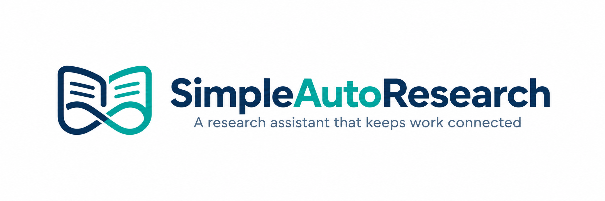

 # SimpleAutoResearch

**A continuing research assistant that works across sources, code, data, figures and editable reports.**

[中文](README_zh.md) · [Get started](docs/USAGE.md) · [Documentation](docs/README.md) · [Showcase](docs/showcase/README.md)

Research carries context forward: a source informs a method, code turns it into a calculation, results become figures and prose, and feedback changes the next step. SimpleAutoResearch keeps this work in a saved task so you can inspect the evidence, reuse existing results and continue with new instructions.

You set the research question, resources and scientific judgments. The assistant investigates materials, proposes and uses tools within your permissions, and prepares artifacts for review.

## Start with the work you have

| Your starting point | Work to ask for | Deliverables to inspect |
| --- | --- | --- |
| A research direction and constraints | Find sources, compare approaches and investigate a promising route | Source references, comparisons, a report and open questions |
| A code requirement or an existing project | Create or modify code, investigate failures and validate behavior | Editable source, changes, execution logs and unresolved issues |
| Data and a description of its fields | Check observations, analyse results and build figures | Analysis scripts, numerical tables, plots and explanations |
| A paper, implementation and available resources | Scope and run a bounded reproduction | Actual protocol, environment, measurements and differences |
| Existing results, figures or a draft | Revise a figure, reorganize arguments or assemble a report | Revised artifacts, retained originals, references and optional ACM LaTeX/PDF |

These capabilities can combine within one task. A figure revision can reuse saved data; writing can use existing calculations; a missing piece of evidence can send the assistant back to investigation. They are not a fixed pipeline that every request must traverse.

## See the delivered work

Start with a complete report or replay a delivered figure. Source, saved inputs and build instructions are included—not just screenshots. These are human-assisted development cases, not unattended one-click results or benchmark scores.

### Saved results → analysis, a five-panel figure and a report

A task compared calibration model forms, update policies, coverage and recorded computation cost. Feedback corrected figures and explanations; the final delivery contains a six-page PDF, four tables, editable code and frozen inputs. No models were refit for this report.


[Read the report](examples/saved-results-report/report/report.pdf) · [Replay without an API key](examples/saved-results-report/README.md) · [Versions, human involvement and cost](docs/showcase/README.md)

### Robotics → a source-backed technical survey

A ten-page survey compares VLA policies with world models: prediction targets, control-loop roles and the breadth of published evidence. It includes 16 references, two explanatory figures, two tables and editable Markdown/LaTeX. It is a bounded reading report, not a comprehensive 2026 review.


[Read the survey](examples/robotics-survey/report/survey.pdf) · [中文简报](examples/robotics-survey/report/briefing_zh.md) · [Rebuild the report](examples/robotics-survey/README.md)

Framework tasks generated the prose and figure code; people supplied goals, feedback, approvals and independent checks. Both tasks required development repairs and explicit continuations and retain `partial` status. [Provenance, versions and cost](docs/showcase/README.md) are documented with the cases rather than presented as one-click success or general success rates.

### Figure feedback without rerunning an experiment

An earlier inspected task revised a saved-result landscape figure into paired visual comparisons, preserving all eight numerical labels and explicit units/scales. Editable source and data let you replay it without a model call.


[Replay with source and saved data—no API key](examples/figure-feedback/README.md) · [Before/after and cost](docs/showcase/README.md#landscape-comparison-a-current-replayable-export)

This bounded feedback task used 11 model requests and 211,774 recorded tokens; it did not refit models. [Earlier Bike Sharing and method-figure results](docs/showcase/README.md#earlier-results) retain their original versions. The [showcase](docs/showcase/README.md) explains provenance, human participation and limits.

## How a task continues

1. **Describe the goal and provide materials.** Start with a question, files, data or a project; state the resources and constraints that matter.
2. **Inspect the work as it develops.** The assistant chooses its next action from sources, code, computation, figures and writing. Saved execution records, model usage and artifact versions help you examine what happened.
3. **Review deliverables and give feedback.** Open the printed artifact paths, check evidence and unresolved issues, then continue the same task with targeted changes or additional materials.

Named TOML profiles configure model connections and purpose routes. Text, code, writing, vision and image generation can use different backends; API keys are referenced through environment variables or a private `.env`. See [model configuration](docs/CONFIG_REFERENCE.md).

## Quick start

Install Python 3.12+, Git, [uv](https://docs.astral.sh/uv/) and ripgrep (`rg`) on the execution machine. Clone the main branch:

```bash
git clone --branch main https://github.com/MKC-ShenZhi/SimpleAutoResearch.git
cd SimpleAutoResearch
uv sync --locked
```

### First, try an offline example

```bash
uv run python examples/figure-feedback/build_figure_v2.py --output runs/examples/figure-feedback/replay
```

Use a fresh output directory. Open its `main.png` or `main.svg`. This runs delivered code on saved results without a key, network or training; it is not a new model-generated result. For complete figure/table/report sources, see [saved-result analysis](examples/saved-results-report/README.md).

### Then, configure a model for new work

Follow [model setup](docs/USAGE.md) to create a TOML catalog with a named `daily` profile, the service's actual endpoint and model ID, and its credential environment variable. The guide covers the default catalog location, custom paths and private `.env` setup.

Check that the local configuration resolves:

```bash
uv run simple-ar models --profile daily --purpose text
```

This checks local configuration and credential availability; it does not establish that the remote API works.

### Start a task with material already in the repository

```bash
uv run simple-ar start "Use the supplied curve data and configuration to write a short Markdown explanation. Distinguish demonstration values from measured experiments, state evidence limits and retain the first version." --source examples/data-curves --model profile:daily --yes
```

This is a model-assisted task using supplied demonstration data. `--yes` accepts the displayed task summary. Replace the source path and goal for your own work; repeated `--source PATH` options add materials.

For analysis that needs computation, a task can request executable work:

```bash
uv run simple-ar start "Analyse these results. Check fields and missing values, create a multi-panel figure and explanation, and deliver rerunnable source." --source ./results --model profile:daily --allow-execution
```

Replace `./results` with an existing directory on the execution machine. `--allow-execution` permits command proposals; each command still requires approval. Add `--allow-network` when the task needs public-source retrieval. Vision and image routes and their permissions are described in the [task guides](docs/WORKFLOWS.md).

### View results and give feedback

Replace `SESSION` with the printed `Task session` path:

```bash
uv run simple-ar results "SESSION"
uv run simple-ar start --resume-task "SESSION" "Keep the first version, add a section on missing-value handling and evidence limits, and deliver a separate feedback version."
uv run simple-ar results "SESSION"
```

Open the actual paths printed by `results`. Check the text, sources, calculations, validation status and outstanding issues. Feedback continues with the saved materials, connections, permissions and budget; add `--source PATH` to supply more evidence. Approval, pause and recovery instructions are in [Get started](docs/USAGE.md).

## Scope and review

The tutorial targets main. The development branch is still improving long tasks and feedback delivery; use documentation for your installed version rather than treating development progress as released capability.

SimpleAutoResearch is a **source-visible preview**, and the native `start` entry is experimental. Current work focuses on Python research code, common tabular data, bounded investigations and reproductions, and reports grounded in available materials. Complex environment preparation, long surveys, precise publication layout and consistent efficiency still need improvement.

Source originals are mounted read-only. You review command proposals and approve execution; a task workspace is not an operating-system sandbox. You remain responsible for scientific interpretation and the delivered evidence: successful execution or PDF compilation alone does not establish scientific correctness. Model choice, services, data and environment affect outcomes and cost. Case-specific details are in the [showcase](docs/showcase/README.md).

## Documentation and contribution

| You want to… | Read |
| --- | --- |
| Install, configure and finish a first task | [Get started](docs/USAGE.md) |
| Choose inputs and follow a task recipe | [Task guides](docs/WORKFLOWS.md) |
| Look up commands, approvals and recovery | [CLI reference](docs/CLI_REFERENCE.md) |
| Configure named models, routes and task fields | [Configuration reference](docs/CONFIG_REFERENCE.md) |
| Inspect showcased outputs and their conditions | [Showcase](docs/showcase/README.md) |
| Understand the code and development workflow | [Development](docs/DEVELOPMENT.md) |
| See what changed | [Changelog](CHANGELOG.md) |

There are no current official benchmark scores or general task success rates. Public cases demonstrate specific work and its conditions.

Reproducible issues with redacted diagnostics are welcome. Include the goal, relevant inputs, command, observed behavior and expected result. Licensing has not yet been selected; discuss code contributions before opening a PR.

Task collaboration draws on [AutoResearchClaw](https://github.com/aiming-lab/AutoResearchClaw), [OpenResearch](https://github.com/alphaXiv/OpenResearch) and [ARIS](https://github.com/wanshuiyin/Auto-claude-code-research-in-sleep).
