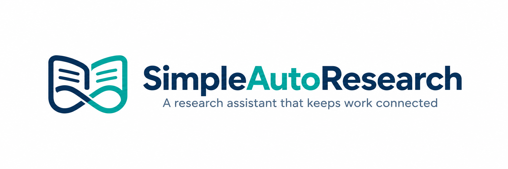
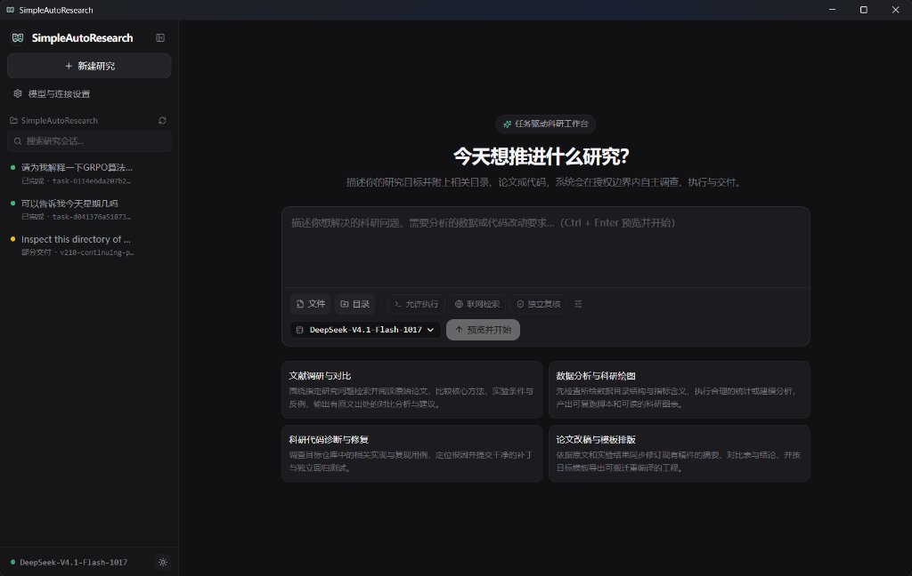
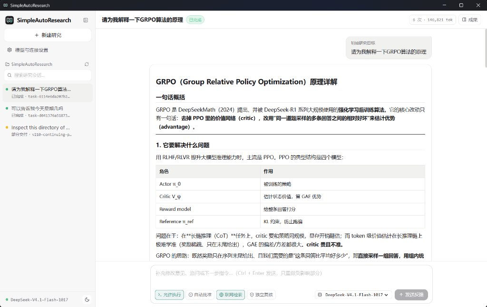
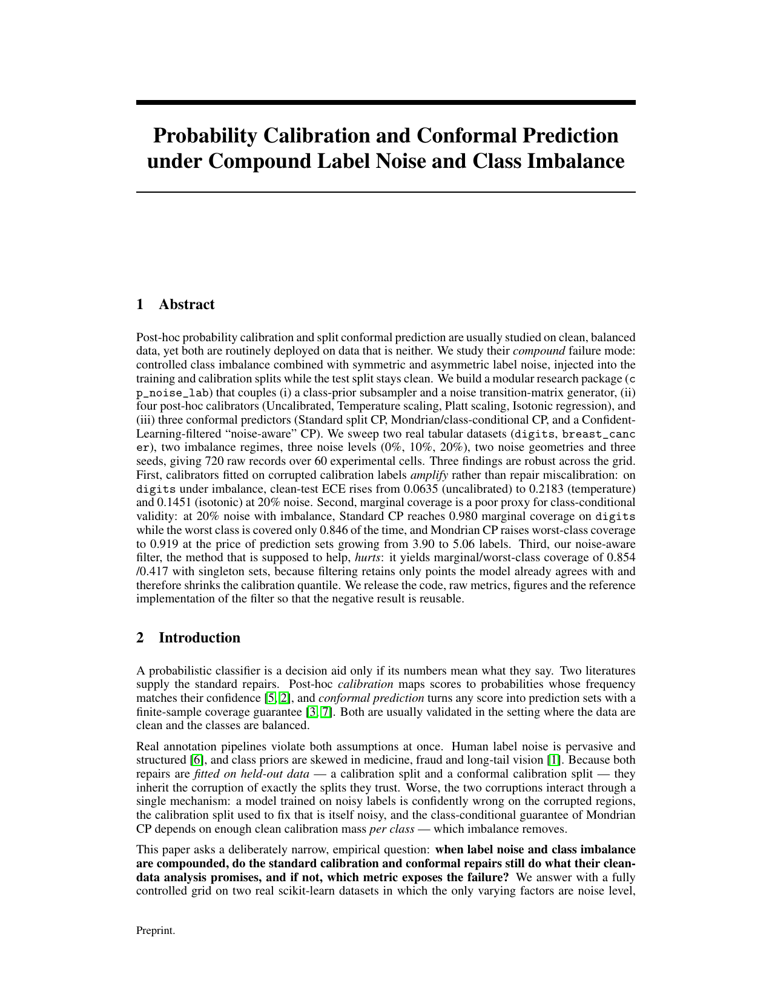
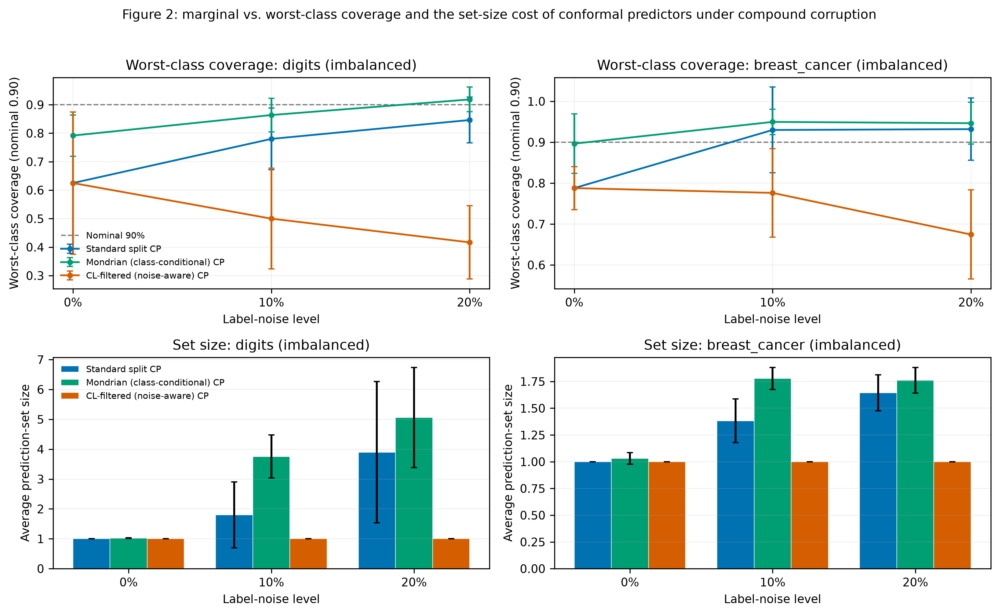
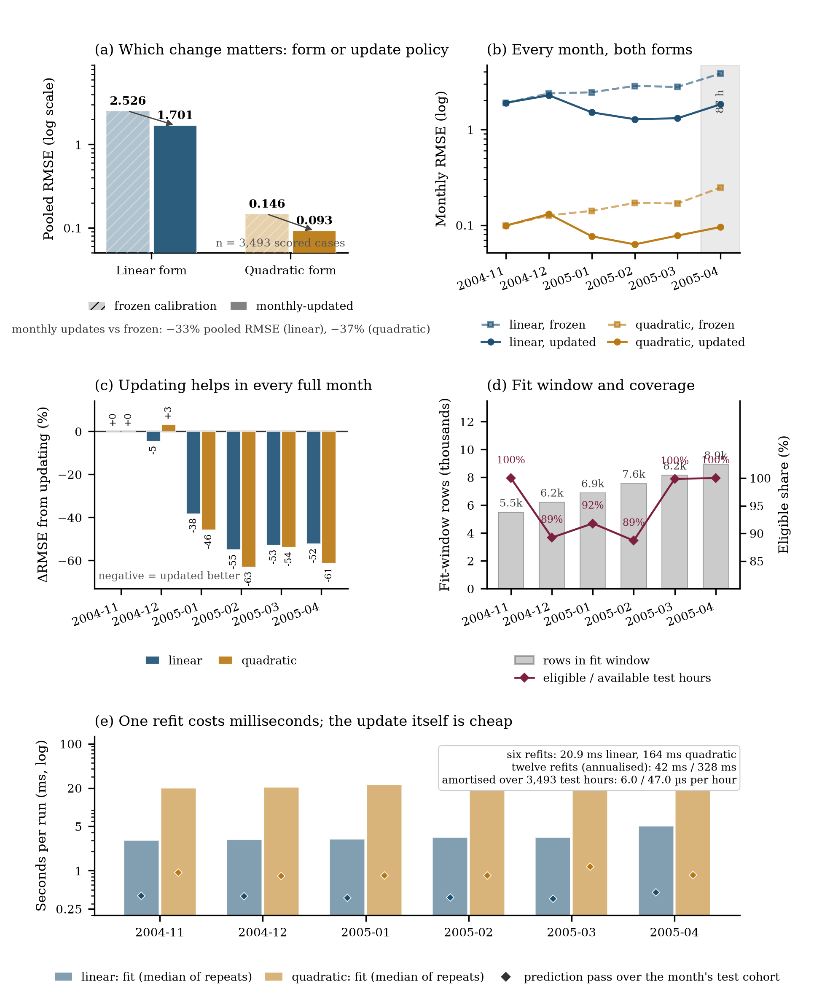
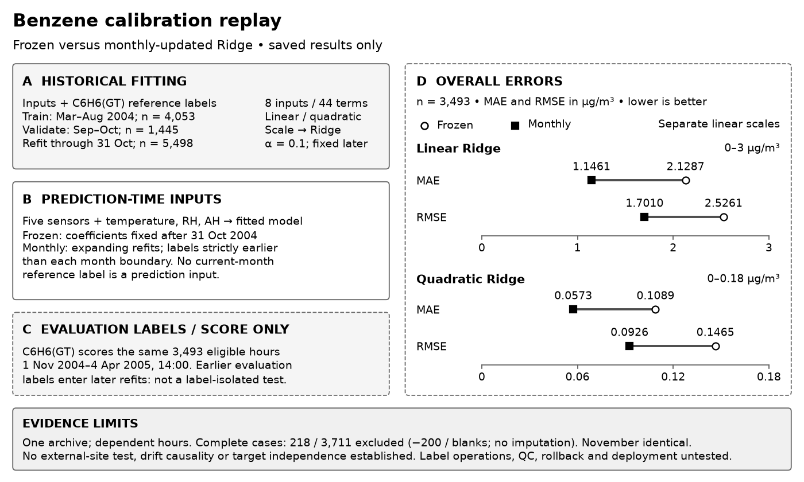

<p align="center">
  
</p>

<h1 align="center">SimpleAutoResearch</h1>

<p align="center">
  <strong>本地优先、证据可核验的持续科研助手：把文献调研、实验代码、科研绘图、独立复核与论文排版放进同一个可续作工作台。</strong>
</p>

<p align="center">
  
  
  
  
</p>

<p align="center">
  <a href="README.md">English</a> ·
  <a href="#桌面研究工作台">桌面工作台</a> ·
  <a href="#真实科研交付展示">成果展示</a> ·
  <a href="#3-分钟快速开始">快速开始</a> ·
  <a href="docs/README_zh.md">文档导航</a> ·
  <a href="CHANGELOG_zh.md">更新记录</a>
</p>

---

科研很少是一次性脚本能跑完的流水线：文献决定假设，代码跑出测量，图表暴露问题，独立审稿抓出矛盾，人的反馈又决定下一步迭代。**SimpleAutoResearch** 把这些步骤保存在同一个可检查、可暂停、可复用的本地任务账本中——你掌握研究问题、权限审批与科学判断，助手在授权边界内自主调查、执行、自查并交付可编辑成果。

---

## 桌面研究工作台

内置基于 React + Tailwind + KaTeX 与原生 WebView 的桌面工作台（`simple-ar-desktop`），与 CLI 共享同一套任务账本与 `models.toml` 配置：支持深浅主题切换、新建即自动运行、执行权限审批、预算触顶一键追加额度续跑、历史会话检索，以及 Markdown、数学公式、图片与分页 PDF 的原生预览。

<table>
  <tr>
    <td width="50%">
      
      <p align="center"><sub>深色模式 · 新建研究、挂载材料、权限开关与科研快捷模板</sub></p>
    </td>
    <td width="50%">
      
      <p align="center"><sub>浅色模式 · 结构化对话流、实时账本统计与底部反馈续作栏</sub></p>
    </td>
  </tr>
</table>

---

## 为什么选择 SimpleAutoResearch

| 核心特性 | 具体能力 |
|---|---|
| **持续项目与跨任务复用** | 随时在安全边界暂停，沿原任务和原账本恢复；支持 `--resume-task` 定向反馈改图/改稿、`--from-session ... --reuse artifacts` 将已交付代码库与 `SKILL.md` 迁移到新数据集、`--retry-model` 断线无损续接、`--authorize-remaining` 追加额度继续。 |
| **独立复核与诚实交付** | 默认由独立复核代理核查原始数据、代码实现与正文陈述之间的一致性；抓出真实矛盾时退回修订，若预算或能力受限则诚实落盘 `partial` 并列出精确 `unresolved` 清单，**绝不伪造 `completed`**。 |
| **完整科研与出版闭环** | 联网检索公开文献（可核验 DOI / BibTeX）→ 从零编写或改造模块化实验代码 → 生成高分辨率出版图 → 导出可独立编译的中文 XeLaTeX 或外供会议模板（如 NeurIPS 2025 / ACM）PDF 工程。 |
| **本地优先与安全边界** | 原始数据与文献只读挂载；命令执行需显式批准（Linux 支持 `bwrap` 沙箱隔离）；资源账本严格控制调用次数、Token 与进程预算；模型密钥仅保留在本地环境变量或系统凭据管理器。 |

---

## 真实科研交付展示

这里展示的是框架真实跑出的交付物、复核记录与局限性，不作为“一键满分”或 benchmark 成功率承诺。完整源码、成本明细与复现条件见[成果展示](docs/showcase/README_zh.md)。

### 1. 英文机器学习顶会论文闭环 + 跨数据集方法复用（NeurIPS 2025 模板）

- **唯一输入**：仅只读挂载一份官方 `neurips_2025.sty` 模板，零预设代码、零预设数据、零人工干预。
- **自主产出**：联网检索 8 篇可核验 DOI 的 BibTeX 文献 → 从零编写 7 模块 `cp_noise_lab/` 代码库 → 在 `digits` 与 `breast_cancer` 上完成 60 组配置 × 多随机种子 = **720 条受控实验** → 生成 3 张英文出版级 PNG 图 → 编译导出 **9 页官方 NeurIPS 2025 英文 PDF** 与可复用 `SKILL.md`。
- **真实复核与跨项目复用**：独立复核精准抓出了 `SKILL.md` 的 2 处接口名漂移（主代理当场重写修正）以及正文 1 处过强表述，并在 70 次调用触顶时诚实落盘 `partial`；随后通过 `--from-session ... --reuse artifacts` 将这套代码库与 `SKILL.md` 迁移至全新 `wine` 三分类数据集，经独立复核通过并完成 `completed`（18 项交付）。

<table>
  <tr>
    <td width="46%">
      
      <p align="center"><sub>官方 <code>neurips_2025.sty</code> 编译的 9 页英文论文首页</sub></p>
    </td>
    <td width="54%">
      
      <p align="center"><sub>图 2：不平衡 + 标签噪声下最差类覆盖率与预测集大小权衡</sub></p>
    </td>
  </tr>
</table>

### 2. 保存结果分析 → 五面板图与可复跑报告

在不重做实验的前提下分析冻结校准结果，经人工反馈修正计时汇总、标签与解释，交付 6 页 PDF、五面板图、四张表、绘图源码与可编辑 TeX（[阅读报告](examples/saved-results-report/report/report.pdf) · [无需密钥复跑](examples/saved-results-report/README_zh.md)）。



### 3. 不重做实验的图形反馈（离线可复跑）

通过定向反馈将保存结果的横版图重构为配对视觉对比，完整保留全部数值、单位与尺度，仅耗 11 次模型请求，无须重拟合（[无需密钥复跑源码](examples/figure-feedback/README_zh.md) · [前后对照](docs/showcase/README_zh.md#横版比较图当前可复跑导出)）。



---

## 3 分钟快速开始

执行机器需要 Python 3.12+、Git、[uv](https://docs.astral.sh/uv/) 和 ripgrep（`rg`）。

```bash
git clone --branch main https://github.com/MKC-ShenZhi/SimpleAutoResearch.git
cd SimpleAutoResearch
uv sync --locked --extra desktop
```

### 方式 A：启动桌面研究工作台（推荐）

```bash
uv run simple-ar-desktop
```

在工作台左侧 **“模型与连接设置”** 中填写你的 OpenAI 兼容端点、模型 ID 和 API Key（与 CLI 共用 `models.toml`），即可在界面中新建任务、挂载目录/文件、一键启动并预览成果。

### 方式 B：使用 CLI 运行、反馈与跨项目复用

先体验一个无需 API Key 的离线绘图复跑：

```bash
uv run python examples/figure-feedback/build_figure_v2.py --output runs/examples/figure-feedback/replay
```

配置好 `models.toml` 中的 `daily` profile（详见[开始使用](docs/USAGE_zh.md)）后，即可启动真实任务：

```bash
# 1. 启动新任务（--allow-execution 允许提案执行；--allow-network 允许公开文献检索）
uv run simple-ar start "分析这些实验结果，绘制多面板对比图并撰写可复跑报告。" \
  --source ./results --model profile:daily --allow-execution --yes

# 2. 查看交付物、账本与未解决项
uv run simple-ar results "SESSION_PATH"

# 3. 沿原会话提交定向反馈（复用已有计算，不重做无关部分）
uv run simple-ar start --resume-task "SESSION_PATH" "补充缺失值敏感性分析并更新图 1。"

# 4. 跨项目复用已交付方法与代码到新数据集
uv run simple-ar start --from-session "SESSION_PATH" --reuse artifacts \
  --source ./new_dataset --model profile:daily --allow-execution "将已有方法迁移至新数据集并对比结论。"
```

---

## 文档导航

[完整文档索引](docs/README_zh.md)按入门、任务、参考与开发分层：

| 你想做什么 | 阅读入口 |
|---|---|
| 安装、配置模型并跑通第一个任务 | [开始使用](docs/USAGE_zh.md) |
| 按调研 / 代码 / 数据 / 写作场景查看配方 | [任务指南](docs/WORKFLOWS_zh.md) |
| 查看更多真实交付物、成本与边界条件 | [成果展示](docs/showcase/README_zh.md) |
| 查询完整 CLI 参数、审批与恢复命令 | [CLI 参考](docs/CLI_REFERENCE_zh.md) |
| 配置多模型路由、视觉/图像后端与预算字段 | [配置参考](docs/CONFIG_REFERENCE_zh.md) |
| 了解架构设计与本地测试套件 | [开发指南](docs/DEVELOPMENT_zh.md) |
| 查看版本演进与近期改动 | [更新记录](CHANGELOG_zh.md) |

---

## 适用范围与审阅边界

- 项目目前为**源码可见预览**，重点面向 Python 科研代码、表格/数值实验、范围明确的文献调研与有限复现，以及有证据依据的学术报告与论文导出。
- 原始来源始终只读挂载，命令执行由用户显式批准（普通模式非 OS 沙箱；Linux 环境下可通过 `--sandbox-execution` 启用 `bwrap` 沙箱）。
- **科学判断与最终签收责任始终在人**：进程退出码为 0、独立复核通过或 PDF 编译成功，均不自动等同于科学结论无误；模型能力、服务稳定性与输入数据质量都会影响最终产出与成本。
- 欢迎提交可复现的问题与脱敏诊断；许可证尚未确定，代码贡献请先沟通再提交 PR。

任务协作与研究工作台理念参考了 [AutoResearchClaw](https://github.com/aiming-lab/AutoResearchClaw)、[OpenResearch](https://github.com/alphaXiv/OpenResearch) 与 [ARIS](https://github.com/wanshuiyin/Auto-claude-code-research-in-sleep)。
