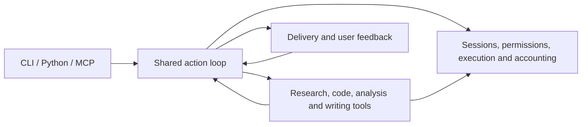

# Development guide

Use this guide to find the owner of a change, implement it and verify its effect.
For installation and first use, start with [Get started](USAGE.md).

[中文](DEVELOPMENT_zh.md) · [CLI reference](CLI_REFERENCE.md) · [Configuration](CONFIG_REFERENCE.md) · [Evidence and limits](EVALUATION.md)

## Set up a development environment

Use Python 3.12+, Git, uv and ripgrep. From the repository root:

```bash
uv sync --locked --extra examples
uv run simple-ar --help
uv run simple-ar-checks --list
```

The `examples` extra supports execution cases. Offline checks need no model key;
configure a connection only for checks that actually call a provider.
Use `uv sync --inexact --extra examples` when a shared environment must retain
additional scientific packages. Keep large benchmark environments separate.

## Architecture and code ownership

A task supplies a goal, materials and authorization. The application selects
necessary operations, observes their results and continues or delivers. Research,
code, analysis and writing are reusable capabilities; a task may combine them.



The application coordinates work; domain modules own their professional operations.
All operations use the same execution records and resource accounting. Task-local
scripts can provide a parser, calculation or plot when an existing operation is
insufficient; they remain subject to the task's permissions.

| Change | Start here |
| --- | --- |
| CLI inputs and configuration | [CLI](../src/simple_ar/cli/), [task intake](../src/simple_ar/app/research_intake.py) |
| Decisions, feedback and task lifecycle | [ToolApplication](../src/simple_ar/app/tool_application.py), [OperationTools](../src/simple_ar/app/operation_tools.py) |
| Files, edits and approved commands | [Workspace](../src/simple_ar/tools/workspace.py), [process lifecycle](../src/simple_ar/core/process.py) |
| Retrieval, reading and source evidence | [research](../src/simple_ar/research/) |
| Code creation, repair and validation | [code_task](../src/simple_ar/code_task/) |
| Numerical analysis and data figures | [result_analysis](../src/simple_ar/result_analysis/) |
| Writing, citations and publication | [report](../src/simple_ar/report/), [publication tool](../src/simple_ar/tools/publication.py) |
| Provider connections and shared accounting | [integrations](../src/simple_ar/integrations/), [budget](../src/simple_ar/core/budget.py) |

Saved sessions and explicit compatibility APIs may still use
[ResearchApplication](../src/simple_ar/app/research_application.py). They retain their
recorded execution contracts. New-task changes should follow the shared action loop.

## Implement a change

Trace one real consumer from its input to the delivered result:

1. Define the user behavior and which module owns it.
2. Reuse an existing operation or add a typed tool contract at the appropriate boundary.
3. Connect its actual consumers, including feedback and recovery where relevant.
4. Retire the implementation and duplicate tests it replaces.
5. Verify the behavior with a different input or starting condition.

Keep professional decisions in their domain. Consumers should use public results
and provenance rather than the producer's private directories or repair rounds.
A refactor should replace a responsibility, not merely move functions or wrap an
old implementation. Prefer existing dependencies and mature libraries; a new
library should remove work the project otherwise has to maintain.

Tool interfaces live in [specifications](../src/simple_ar/tools/specs.py),
[registration](../src/simple_ar/tools/registry.py) and
[the gateway](../src/simple_ar/tools/gateway.py). For a trusted local skill or tool,
follow [configuration reference](CONFIG_REFERENCE.md#trusted-local-packages) and the [runnable example](../examples/local_extension/extension.toml).
That interface currently supports instructions and read-only/plan operations;
permission declarations do not provide OS isolation.

## Preserve task and result contracts

| Boundary | What a change must preserve |
| --- | --- |
| Materials | Read-only originals, their identity and observed byte ranges; generated explanation is not original evidence. |
| Execution | Approved scope, actual input versions, commands, exit status and logs. A workspace is not an OS sandbox. |
| Results | Distinguish candidates, recorded production and accepted delivery. Keep source, tables, figures and requested exports consistent. |
| Continuation | Retain useful prior work and its provenance. A recorded output hash does not certify its current bytes. |
| Accounting | Share the existing ledger across all subcalls; retain failures and unknown charges. Never infer zero usage from a connection error. |
| Recovery | Reconcile completed work through its owner. Do not blindly replay uncertain side effects or silently upgrade a saved contract. |

Missing files or failed checks must remain visible without erasing other usable
results. A successful process, valid citation marker or compiled PDF alone does
not establish scientific correctness. Plain Markdown delivery needs no PDF unless
the user requests publication.

Exact settings belong in [Configuration](CONFIG_REFERENCE.md); commands for
supplying inputs, approving work and resuming are in
[Native recovery](CLI_REFERENCE.md#native-recovery). Do not edit a saved manifest
or ledger to bypass those operations.

## Verify a change

Start with the affected behavior and its direct consumers. Use broader checks for
shared-boundary changes or a release candidate, rather than after every small edit.

```bash
uv run simple-ar-checks --list
uv run simple-ar-checks intake
uv run --extra examples simple-ar-checks all
```

| Area | Check groups |
| --- | --- |
| CLI and configuration | `quick`, `intake` |
| Application, sessions and recovery | `core`, `application` |
| Retrieval and code | `research`, `code-task` |
| Analysis and writing | `data`, `report` |
| Provider transport and real execution | `llm`, `execution` |

Groups are selected smoke checks, not proof of complete domain coverage. Run a
specific module when that gives a faster, meaningful answer:

```bash
uv run python -m unittest tests.test_working_context
uv run --extra examples python -m unittest discover -s tests -t .
```

Use `-t .` for full discovery so shared fixtures resolve through the `tests` package.
Prefer behavior tests over tests of every private helper. Consolidate duplicated
scenarios without combining unrelated behaviors into a giant test method.

Real-task acceptance is separate: inspect delivered content, calculations, figures,
feedback changes and reproducibility. Record model costs and human intervention;
offline mocks and successful exits cannot replace those checks.

## Build and submit

```bash
git diff --check
uv build
```

[Packaging rules](../pyproject.toml) include application source and report templates
in the wheel. Installed commands must not depend on repository-only scripts or
private planning files. Check the installed package when changing that boundary.

Before submitting, confirm that callers and configuration agree, replaced code and
tests have retired, and documented behavior matches the implementation. Keep keys,
runtime outputs and caches out of the change. State any verification limits.
Licensing has not yet been selected; discuss code contributions first.

The [CI configuration](../.github/workflows/ci.yml) describes automated checks.
Changing documentation does not require enabling repository workflows.

## Maintain documentation

Choose the page by the reader's question:

| Reader needs | Page |
| --- | --- |
| Finish a first task | [Get started](USAGE.md) |
| Follow a task recipe | [Task guides](WORKFLOWS.md) |
| Look up a command or setting | [CLI](CLI_REFERENCE.md), [Configuration](CONFIG_REFERENCE.md) |
| Add a trusted local package | [Configuration reference](CONFIG_REFERENCE.md#trusted-local-packages) |
| Understand implementation and contribution | This guide |
| Check demonstrated scope and limitations | [Evaluation](EVALUATION.md), [showcase](showcase/README.md) |
| See user-visible changes | [Changelog](../CHANGELOG.md) |

Rewrite the relevant section when behavior changes. Keep one authoritative
explanation and link to it; do not append patch histories or copy protocol details
across pages. Examples should lead to a useful result, and reference entries should
make values and constraints easy to find.

Keep Chinese and English structure and facts aligned, and check links after changing
headings. Follow the [Changelog guidelines](CHANGELOG_GUIDE.md) for dated entries.
Public instructions must stand on their own without private `MDfiles/` records.
