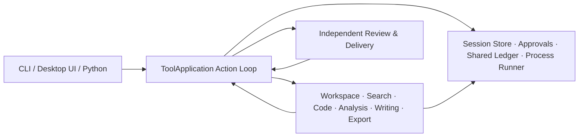

# Development Guide

This guide helps contributors set up the environment, understand core architectural invariants, locate module owners, and run verification suites. For installation and first-time usage, start with [Get started](USAGE.md).

[中文](DEVELOPMENT_zh.md) · [CLI reference](CLI_REFERENCE.md) · [Configuration](CONFIG_REFERENCE.md) · [Showcase](showcase/README.md)

---

## 1. Set Up a Development Environment

Requires Python 3.12+, Git, [uv](https://docs.astral.sh/uv/), and ripgrep (`rg`). Node.js 20+ is also required when modifying the desktop workbench frontend.

```bash
uv sync --locked --extra examples --extra desktop
uv run simple-ar --help
uv run simple-ar-checks --list
```

- Offline test suites require no model API keys; configure `models.toml` and `.env` only for live provider tests.
- In shared scientific environments where extra installed packages should be preserved, use `uv sync --inexact --extra examples`.

---

## 2. Core Architecture & Invariants

SimpleAutoResearch centers on a **single resumable task session and shared resource ledger**, coordinating literature search, code work, data analysis, plotting, writing/publication, and independent review inside one native action loop:



Keep these five invariants intact when making changes:

1. **Read-only sources & explicit permissions**: user-supplied source materials are always mounted read-only; process commands require explicit approval (with optional Linux `bwrap` isolation via `--sandbox-execution`); loading tools or reading external text (including `SKILL.md`) never grants authority.
2. **One ledger & honest accounting**: model calls, tokens, process invocations, and source operations share one task ledger. Interrupted or failed calls preserve unknown reservations rather than silently erasing them; continuation happens explicitly via `--retry-model` or `--authorize-remaining`.
3. **Version binding & evidence provenance**: reads, edits, copies, publication exports, and reviews bind concrete paths and SHA-256 digests so prior versions are never silently overwritten and unexecuted checks are never fabricated.
4. **Independent review & honest delivery**: an independent reviewer checks original evidence against claims, returning `needs_revision` on blocking defects. When budget or capability boundaries prevent full verification, the session preserves usable work and delivers an honest `partial` with explicit `unresolved` items—never faking `completed`.
5. **Saved session compatibility**: new tasks use the current native contract (`ToolApplication` + `create_research_task` / `start_research_task`); existing saved sessions continue under their recorded contracts.

---

## 3. Code Ownership Map

| Area | Primary modules |
|---|---|
| CLI entry & intake | [cli/main.py](../src/simple_ar/cli/main.py), [cli/code_task_commands.py](../src/simple_ar/cli/code_task_commands.py), [app/research_intake.py](../src/simple_ar/app/research_intake.py) |
| Desktop workbench | [desktop.py](../src/simple_ar/desktop.py), [ui.py](../src/simple_ar/ui.py), [desktop-ui/](../desktop-ui/) |
| Action loop, contracts & delivery | [app/tool_application.py](../src/simple_ar/app/tool_application.py), [app/tool_contracts.py](../src/simple_ar/app/tool_contracts.py), [app/tool_messages.py](../src/simple_ar/app/tool_messages.py), [app/tool_delivery.py](../src/simple_ar/app/tool_delivery.py), [app/services.py](../src/simple_ar/app/services.py) |
| Context selection & memory | [core/working_context.py](../src/simple_ar/core/working_context.py), [app/work_memory.py](../src/simple_ar/app/work_memory.py) |
| Workspace, copies & processes | [tools/workspace.py](../src/simple_ar/tools/workspace.py), [tools/workspace_models.py](../src/simple_ar/tools/workspace_models.py), [tools/workspace_delivery.py](../src/simple_ar/tools/workspace_delivery.py), [core/process.py](../src/simple_ar/core/process.py) |
| Independent review & audit | [tools/inspection.py](../src/simple_ar/tools/inspection.py), [tools/inspection_contracts.py](../src/simple_ar/tools/inspection_contracts.py), [tools/inspection_evidence.py](../src/simple_ar/tools/inspection_evidence.py), [tools/inspection_messages.py](../src/simple_ar/tools/inspection_messages.py), [tools/delivery_review.py](../src/simple_ar/tools/delivery_review.py) |
| Research, code & data analysis | [research/](../src/simple_ar/research/), [code_task/](../src/simple_ar/code_task/), [result_analysis/](../src/simple_ar/result_analysis/) |
| Writing, revision & PDF export | [report/export.py](../src/simple_ar/report/export.py), [report/delivery.py](../src/simple_ar/report/delivery.py), [tools/writing.py](../src/simple_ar/tools/writing.py), [tools/publication.py](../src/simple_ar/tools/publication.py) |
| Model connections & ledger | [integrations/llm.py](../src/simple_ar/integrations/llm.py), [integrations/model_settings.py](../src/simple_ar/integrations/model_settings.py), [core/budget.py](../src/simple_ar/core/budget.py) |

---

## 4. Verification & Builds

### Run automated checks

```bash
# Fast sanity, core contract, and release regression (offline, no API key)
uv run simple-ar-checks quick core release

# Desktop local UI server & API tests
uv run python -m unittest tests.test_local_ui

# Context selection and independent review suites
uv run python -m unittest tests.test_working_context tests.test_delivery_review tests.test_candidate_review_request

# Real XeLaTeX / PDF publication export integration (requires Pandoc & TeX Live)
SAR_TEST_EXPORT_INTEGRATION=1 uv run python -m unittest tests.test_analysis_writing tests.test_candidate_review_request
```

### Rebuild desktop frontend assets

After editing `desktop-ui/`, rebuild and commit the updated bundle under `src/simple_ar/desktop_assets/`:

```bash
cd desktop-ui
npm install
npm run build
```

---

## 5. Documentation & Submission Hygiene

- Record user-visible additions, improvements, and fixes in [CHANGELOG.md](../CHANGELOG.md) and [CHANGELOG_zh.md](../CHANGELOG_zh.md) using reverse-chronological date headings.
- Before pushing, verify no `.env`, credentials, temporary run directories (`runs/`, `.tmp_tests/`), or unintended large binaries are tracked.
