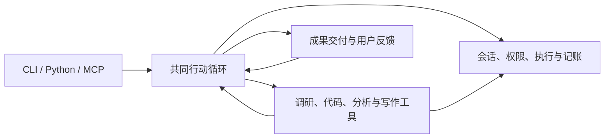

# 开发指南

这份指南帮助贡献者找到改动归属、接通消费者并验证结果。
首次安装和使用请先读[开始使用](USAGE_zh.md)。

[English](DEVELOPMENT.md) · [命令参考](CLI_REFERENCE_zh.md) · [配置参考](CONFIG_REFERENCE_zh.md) · [成果展示](showcase/README_zh.md)

## 准备开发环境

需要 Python 3.12+、Git、uv 和 ripgrep。在仓库根目录运行：

```bash
uv sync --locked --extra examples
uv run simple-ar --help
uv run simple-ar-checks --list
```

`examples` 包含执行示例所需依赖。离线检查不需要模型密钥，只有真实调用提供商时才需配置连接。
共享科研环境如需保留额外依赖，使用 `uv sync --inexact --extra examples`；大型基准环境单独维护。

## 架构与代码归属

用户提供目标、材料和授权。应用层选择必要操作，观察结果，再继续工作或交付。
调研、代码、分析和写作是可组合的能力，同一任务可以按需要调用它们。



应用层协调任务，领域模块承担专业操作；各操作共用执行记录和资源记账。
已有工具不足时，可以在任务授权内生成解析器、分析脚本或绘图代码，再用真实运行结果继续工作。

| 需要修改 | 从这里开始 |
| --- | --- |
| 命令输入与配置 | [CLI](../src/simple_ar/cli/)、[任务输入适配](../src/simple_ar/app/research_intake.py) |
| 行动选择、反馈与任务生命周期 | [ToolApplication](../src/simple_ar/app/tool_application.py)、[OperationTools](../src/simple_ar/app/operation_tools.py) |
| 文件、编辑与批准的命令 | [Workspace](../src/simple_ar/tools/workspace.py)、[进程生命周期](../src/simple_ar/core/process.py) |
| 检索、阅读与来源依据 | [research](../src/simple_ar/research/) |
| 创建、修复与验证代码 | [code_task](../src/simple_ar/code_task/) |
| 数值分析与数据图 | [result_analysis](../src/simple_ar/result_analysis/) |
| 写作、引用与出版 | [report](../src/simple_ar/report/)、[出版工具](../src/simple_ar/tools/publication.py) |
| 模型连接与共享记账 | [integrations](../src/simple_ar/integrations/)、[预算](../src/simple_ar/core/budget.py) |

已保存会话和显式兼容 API 可能仍由 [ResearchApplication](../src/simple_ar/app/research_application.py)
承接，沿保存的执行合同恢复。修改普通新任务时，从共同行动循环追踪调用链。

## 实施一项改动

沿一个真实消费者，从输入追到交付结果：

1. 明确用户行为和负责的模块。
2. 复用已有操作，或在适当边界定义有类型的工具契约。
3. 接通实际消费者，包括相关的反馈和恢复路径。
4. 删除被替代的实现及重复测试。
5. 用另一种输入或起点核对行为。

专业判断留在所属领域；消费者使用公开结果和来源信息，不依赖生产者的私有目录或修复轮次。
重构应替换一项职责，不能只搬函数或在旧实现外再包一层。优先已有依赖和成熟库，
新依赖应当减少项目需要自行维护的工作。

工具接口从[声明](../src/simple_ar/tools/specs.py)、[注册器](../src/simple_ar/tools/registry.py)
和[调用入口](../src/simple_ar/tools/gateway.py)阅读。
可信本地 Skill 或工具按[配置参考](CONFIG_REFERENCE_zh.md#可信本地扩展)及[可运行示例](../examples/local_extension/extension.toml)接入；当前接口支持指令与只读／plan 操作，
权限声明本身不提供操作系统隔离。

## 守住任务与成果约束

| 边界 | 改动必须保留的行为 |
| --- | --- |
| 材料 | 原件只读，保留身份与实际读取范围；生成解释不冒充原文。 |
| 执行 | 核对授权范围、输入版本、命令、退出状态和日志；工作区不是操作系统沙箱。 |
| 成果 | 区分候选、生成记录与已接受交付，源码、表格、图和请求的导出物应保持一致。 |
| 续用 | 保留有效工作及来源；记录中的输出哈希不代表当前文件已经核查。 |
| 记账 | 所有子调用共用既有账本，失败和未知费用保留；连接报错不代表用量为零。 |
| 恢复 | 由原负责人核对保留结果，不盲目重放可能已有副作用的操作，不静默升级旧合同。 |

个别文件缺失或检查失败应明确呈现，不能清空其余可用成果。
进程成功、引用标记有效或 PDF 编译通过，单独都不能证明科学结论正确。
普通 Markdown 交付无需生成 PDF，出版按用户要求进行。

参数的确切含义见[配置参考](CONFIG_REFERENCE_zh.md)；补充材料、审批和续接命令见
[原生任务恢复](CLI_REFERENCE_zh.md#原生任务恢复)。不要编辑已保存的 manifest 或账本绕过这些操作。

## 验证改动

先验证受影响行为和直接消费者；共享边界大改或发布候选再扩大检查，避免每次小改都跑全量。

```bash
uv run simple-ar-checks --list
uv run simple-ar-checks intake
uv run --extra examples simple-ar-checks all
```

| 改动范围 | 检查组 |
| --- | --- |
| CLI 与配置 | `quick`、`intake` |
| 应用、会话与恢复 | `core`、`application` |
| 检索与代码 | `research`、`code-task` |
| 分析与写作 | `data`、`report` |
| 模型传输与真实执行 | `llm`、`execution` |

分组是选定的烟测集合，不代表该领域全部覆盖。需要更快定位时，可以直接选择测试模块：

```bash
uv run python -m unittest tests.test_working_context
uv run --extra examples python -m unittest discover -s tests -t .
```

完整发现使用 `-t .`，让共享夹具从 `tests` 包导入。
测试应保护用户行为，合并重复场景；不要求每个私有函数都有独立测试，也不要把无关行为塞进巨型方法。

真实任务验收另看正文、计算、图形、反馈修改和可复跑性，并记录模型成本与人工参与。
离线 mock 和退出码不能代替这些检查。

## 构建与提交

```bash
git diff --check
uv build
```

[打包规则](../pyproject.toml)将应用源码与报告模板纳入 wheel。
安装后的命令不能依赖仓库专用脚本或私有规划文件；修改打包边界时，要检查实际安装态。

提交前确认入口、配置和消费者一致，被替代代码与测试已退出，文档与实现相符。
不要混入密钥、运行成果或缓存；说明尚未验证的范围。许可证尚未确定，代码贡献请先沟通。

[CI 配置](../.github/workflows/ci.yml)说明自动检查内容，修改文档不要求启用仓库工作流。

## 维护文档

先判断读者要解决什么问题：

| 读者需要 | 文档 |
| --- | --- |
| 完成第一个任务 | [开始使用](USAGE_zh.md) |
| 按具体目标操作 | [任务指南](WORKFLOWS_zh.md) |
| 查命令或参数 | [命令参考](CLI_REFERENCE_zh.md)、[配置参考](CONFIG_REFERENCE_zh.md) |
| 接入可信本地包 | [配置参考](CONFIG_REFERENCE_zh.md#可信本地扩展) |
| 理解实现与参与开发 | 本文 |
| 核对展示范围和限制 | [成果展示](showcase/README_zh.md) |
| 了解用户可感知的变化 | [Changelog](../CHANGELOG_zh.md) |

行为变化时重写对应章节；一项规则保留一个权威位置，其他页面给链接。
不要追加补丁历史或跨页复制协议细节。教程先带人完成任务，参考页让字段值与约束容易查到。

中英文结构与事实同步，改标题后检查链接。Changelog 按 `YYYY-MM-DD` 倒序，
同日合并，以新增、优化、修复记录用户可感知的变化；不写提交流水账或工程测试统计。
公开使用说明应能独立阅读，不依赖私有 `MDfiles/`。
