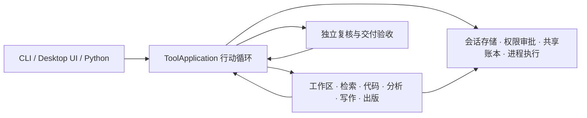

# 开发指南

这份指南帮助贡献者快速搭建环境、理解核心架构边界、定位代码归属并运行自动化测试。首次安装和使用请先读[开始使用](USAGE_zh.md)。

[English](DEVELOPMENT.md) · [命令参考](CLI_REFERENCE_zh.md) · [配置参考](CONFIG_REFERENCE_zh.md) · [成果展示](showcase/README_zh.md)

---

## 1. 准备开发环境

需要 Python 3.12+、Git、[uv](https://docs.astral.sh/uv/) 和 ripgrep（`rg`）；如需修改桌面工作台前端，另需 Node.js 20+。

```bash
uv sync --locked --extra examples --extra desktop
uv run simple-ar --help
uv run simple-ar-checks --list
```

- 离线测试不需要任何模型 API Key；只有在运行真实模型调用或外部集成测试时才需要配置 `models.toml` 与 `.env`。
- 共享科研环境如需保留已有科学计算包，可使用 `uv sync --inexact --extra examples`。

---

## 2. 核心架构与不变量

SimpleAutoResearch 以**单一任务会话 + 共享资源账本**为核心，把文献检索、代码实现、数据分析、图形绘制、写作排版与独立复核组织在同一个原生行动循环中：



改动代码时请始终守住以下 5 条架构不变量：

1. **只读材料与显式授权**：用户提供的原始来源始终只读挂载；任何进程执行都需要显式审批（Linux 下可选 `--sandbox-execution` 启用 `bwrap` 隔离）；加载工具或读取外部文本（含 `SKILL.md`）绝不自动授予权限。
2. **单一账本与诚实结算**：模型请求、Token、进程调用与外部检索共用同一个任务账本；断线或异常时保留未知预留而非静默清零，恢复必须通过显式 `--retry-model` 或 `--authorize-remaining`。
3. **版本绑定与证据溯源**：所有文件读取、编辑、复制、出版导出与独立复核均绑定具体路径与 SHA-256 版本，不靠猜测覆盖用户改动，也不伪造未执行的检查。
4. **独立复核与诚实交付**：独立复核代理基于原始证据独立判断，发现阻塞性缺陷返回 `needs_revision`；若预算或能力受限无法完成全部核查，保留实际可用产出并诚实落盘 `partial` + `unresolved`，绝不伪造 `completed`。
5. **保留历史会话兼容**：新建任务使用当前原生契约（`ToolApplication` + `create_research_task` / `start_research_task`）；改动默认行为或上下文策略时，已保存历史会话沿其记录的合同恢复。

---

## 3. 代码归属速查

| 改动方向 | 主要模块 |
|---|---|
| CLI 入口与参数解析 | [cli/main.py](../src/simple_ar/cli/main.py)、[cli/code_task_commands.py](../src/simple_ar/cli/code_task_commands.py)、[app/research_intake.py](../src/simple_ar/app/research_intake.py) |
| 桌面工作台前后端 | [desktop.py](../src/simple_ar/desktop.py)、[ui.py](../src/simple_ar/ui.py)、[desktop-ui/](../desktop-ui/) |
| 主行动循环、契约与交付 | [app/tool_application.py](../src/simple_ar/app/tool_application.py)、[app/tool_contracts.py](../src/simple_ar/app/tool_contracts.py)、[app/tool_messages.py](../src/simple_ar/app/tool_messages.py)、[app/tool_delivery.py](../src/simple_ar/app/tool_delivery.py)、[app/services.py](../src/simple_ar/app/services.py) |
| 上下文选择与工作记忆 | [core/working_context.py](../src/simple_ar/core/working_context.py)、[app/work_memory.py](../src/simple_ar/app/work_memory.py) |
| 工作区文件、复制与进程执行 | [tools/workspace.py](../src/simple_ar/tools/workspace.py)、[tools/workspace_models.py](../src/simple_ar/tools/workspace_models.py)、[tools/workspace_delivery.py](../src/simple_ar/tools/workspace_delivery.py)、[core/process.py](../src/simple_ar/core/process.py) |
| 独立复核与证据审计 | [tools/inspection.py](../src/simple_ar/tools/inspection.py)、[tools/inspection_contracts.py](../src/simple_ar/tools/inspection_contracts.py)、[tools/inspection_evidence.py](../src/simple_ar/tools/inspection_evidence.py)、[tools/inspection_messages.py](../src/simple_ar/tools/inspection_messages.py)、[tools/delivery_review.py](../src/simple_ar/tools/delivery_review.py) |
| 文献检索、代码与数据分析 | [research/](../src/simple_ar/research/)、[code_task/](../src/simple_ar/code_task/)、[result_analysis/](../src/simple_ar/result_analysis/) |
| 写作、修订与 LaTeX/PDF 出版 | [report/export.py](../src/simple_ar/report/export.py)、[report/delivery.py](../src/simple_ar/report/delivery.py)、[tools/writing.py](../src/simple_ar/tools/writing.py)、[tools/publication.py](../src/simple_ar/tools/publication.py) |
| 模型连接、凭据与共享账本 | [integrations/llm.py](../src/simple_ar/integrations/llm.py)、[integrations/model_settings.py](../src/simple_ar/integrations/model_settings.py)、[core/budget.py](../src/simple_ar/core/budget.py) |

---

## 4. 验证与构建

### 运行自动化测试

```bash
# 日常快速与核心发布回归（离线，无需 API Key）
uv run simple-ar-checks quick core release

# 桌面端本地服务与前端契约测试
uv run python -m unittest tests.test_local_ui

# 上下文与独立复核专项
uv run python -m unittest tests.test_working_context tests.test_delivery_review tests.test_candidate_review_request

# 真实 XeLaTeX / PDF 出版导出集成测试（需本机安装 Pandoc 与 TeX Live）
SAR_TEST_EXPORT_INTEGRATION=1 uv run python -m unittest tests.test_analysis_writing tests.test_candidate_review_request
```

### 重新构建桌面端前端资产

修改 `desktop-ui/` 后需重新构建并一并提交 `src/simple_ar/desktop_assets/`：

```bash
cd desktop-ui
npm install
npm run build
```

---

## 5. 文档与提交规范

- 用户可见的新增、优化或修复请同步记录到 [CHANGELOG_zh.md](../CHANGELOG_zh.md) 与 [CHANGELOG.md](../CHANGELOG.md)（按纯日期标题倒序记录）。
- 提交前确认工作树不包含 `.env`、个人凭据、临时运行目录（`runs/`、`.tmp_tests/`）或未授权的大文件。
