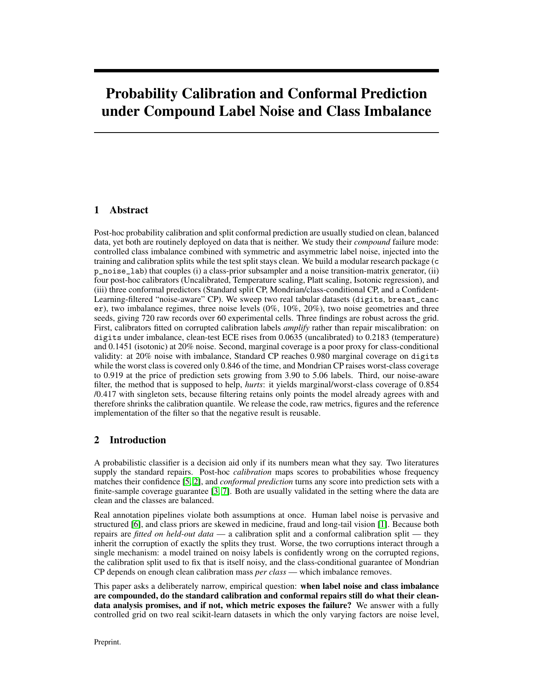
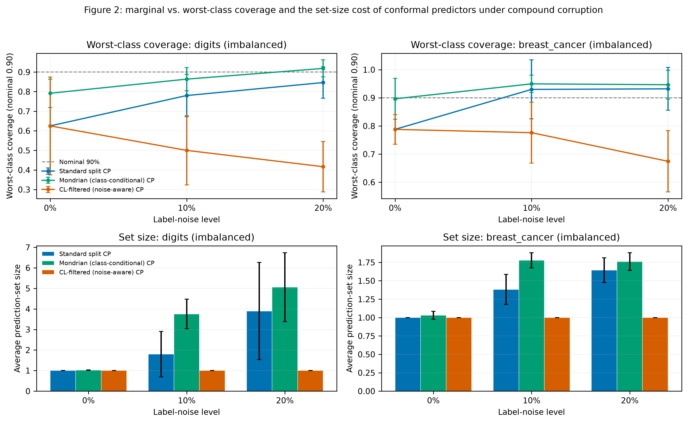
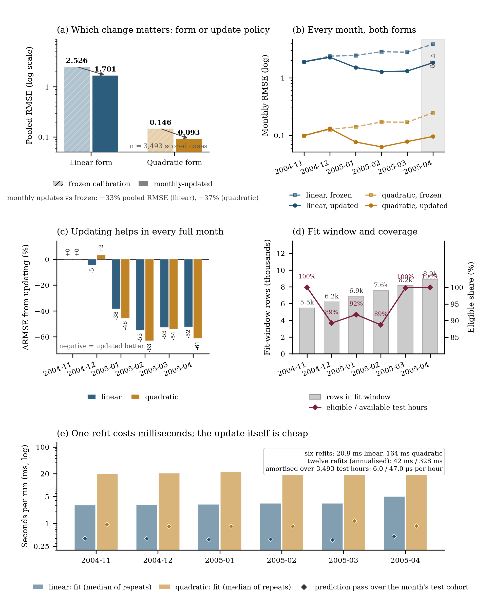
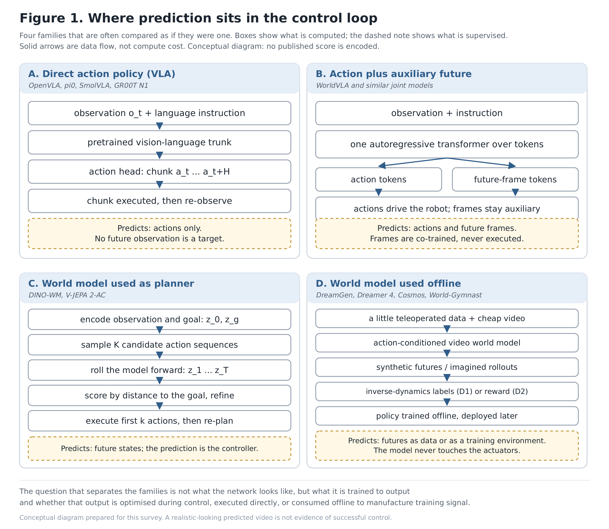
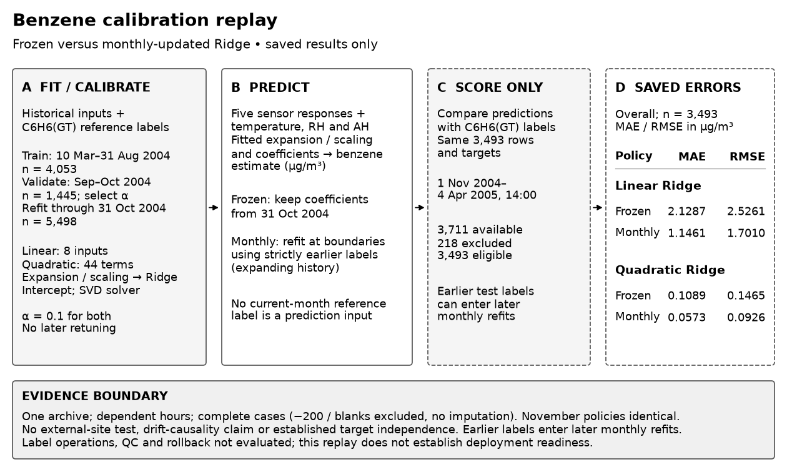
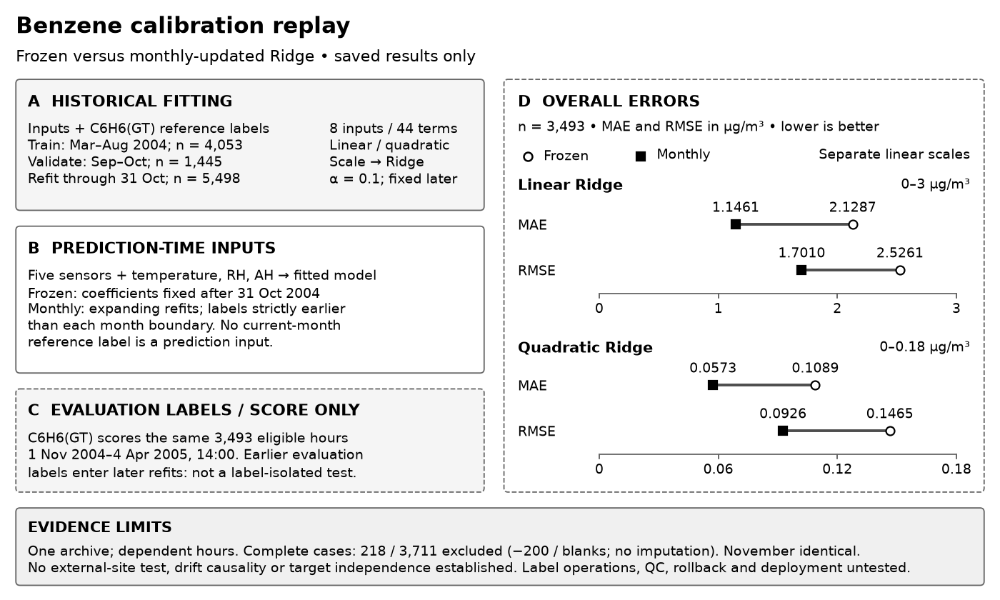

# See what the assistant delivered

[中文](README_zh.md) · [Get started](../USAGE.md) · [Documentation](../README.md)

These cases collect prose, figures and source generated by framework tasks, with reading and rebuild instructions. People supplied goals, execution approvals, defect feedback, environment setup and independent checks. Some tasks required framework repairs and explicit continuation, so each case also explains human involvement, cost and unfinished work.

## End-to-End English ML Paper (NeurIPS 2025) + Cross-Dataset Reuse

**Request:** starting from only one read-only official `neurips_2025.sty` template, run an end-to-end study on *Probability Calibration and Conformal Prediction under Compound Label Noise and Class Imbalance*—retrieve peer-reviewed references with DOIs, build a reusable experiment package, run controlled multi-dataset experiments, generate English publication figures, compile a NeurIPS 2025 PDF and write a reusable `SKILL.md`. Then transfer the delivered package and `SKILL.md` to a brand-new `wine` dataset in a second session via `--from-session ... --reuse artifacts`.

**Delivery & measured outcome:**
- **Primary research session (zero mid-run intervention, Linux `bwrap` sandbox, 70 model calls / 3.34M tokens):** produced an 8-entry DOI-backed `references.bib`, a 7-module `cp_noise_lab/` package, 720 controlled runs across `digits` and `breast_cancer` (60 cells), 3 publication PNG figures and a compiled 9-page NeurIPS 2025 PDF (35 artifacts total). Independent review caught 2 non-existent API references in `SKILL.md` (rewritten immediately) and 1 overstated prose sentence; hitting the 70-call cap before re-exporting the PDF, the session honestly delivered `partial` with 3 explicit `unresolved` items.
- **Cross-dataset reuse session (`--from-session ... --reuse artifacts`, 61 model calls / 2.83M tokens):** reused `cp_noise_lab/` and `SKILL.md` on the new `wine` 3-class dataset, generated transfer figures and `transfer_report.md`, passed independent review (`verdict = passed`) and closed cleanly to `completed` (18 artifacts, `unresolved = []`).

| Compiled 9-page NeurIPS 2025 paper (page 1) | Worst-class coverage vs. set-size trade-off |
| --- | --- |
|  |  |

## Saved results: analysis, figure feedback and a report

**Request:** compare model form, monthly updates, coverage and recorded computation cost without repeating the experiment.

**Delivery:** a six-page PDF, five-panel figure, four tables, frozen inputs, plotting source and editable TeX. Feedback corrected timing aggregates, figure labels and unsupported application interpretations.

[Read the report](../../examples/saved-results-report/report/report.pdf) · [Replay tables/figures and rebuild the PDF](../../examples/saved-results-report/README.md) · [File provenance and hashes](../../examples/saved-results-report/provenance.json)

Independent verification covered 72 numerical conditions and relocated rebuilds; all six final pages were inspected separately. Findings apply to these saved results: no uncertainty intervals, machine-specific timings, annualised cost scenarios rather than measurements, and no established physical domain or target units. Native status remains `partial`.

## Robotics: a direction becomes a technical survey

**Request:** compare what VLA policies and world models predict, where prediction enters control, and the breadth of the evidence.

**Delivery:** a ten-page PDF, 16 references, two explanatory figures, two tables, a Chinese brief and editable Markdown/LaTeX. Figures explain mechanisms and evidence, not invented cross-paper performance rankings.

[Read the survey](../../examples/robotics-survey/report/survey.pdf) · [中文简报](../../examples/robotics-survey/report/briefing_zh.md) · [Source and rebuild instructions](../../examples/robotics-survey/README.md) · [File provenance and hashes](../../examples/robotics-survey/provenance.json)

This is not a comprehensive 2026 review: most sources are from 2024–2025, only two from 2026; some acquired full text was underused and some author metadata remains unverified. The final report passed independent page inspection and relocated compilation, not complete automated vision sign-off. Native status remains `partial`.

## Landscape comparison: a current, replayable export

This earlier case is a convenient no-key first exercise: turn a largely textual result into paired visual comparisons while retaining eight values, units and the two model scales.

| Initial export | After feedback |
| --- | --- |
|  |  |

[Copy the replay command](../../examples/figure-feedback/README.md). Generation used `f45b596`; independent checks verified the eight values and frozen data, and relocated replay matched both PNGs in the same environment. There was no refitting. Original `partial` status and caption limitations remain.

## Human involvement, versions and cost

The two new final deliveries were checked on code equivalent to `d3b0721`, whose fixes are included in main. Public scientific files are byte-identical selections from the deliveries; maintainers wrote the tutorials. Full conversations, journals, prior failures and acquired paper full texts are not redistributed.

| Case | Settled physical requests | Settled tokens | Scope |
| --- | ---: | ---: | --- |
| Saved-result analysis report | 180 | 5,871,880 | All stages, multiple candidates/connections and explicit continuations |
| Robotics survey | 164 | 6,086,900 | All stages, multiple candidates/connections and explicit continuations |
| Landscape figure feedback | 11 | 211,774 | One bounded feedback task; earlier failures recorded separately |

Final writing for the first two used official `deepseek-flash`, low thinking and streaming—not one model throughout. Unknown usage remains reserved in the original journals, not treated as zero or released. These are development histories, not ordinary single-task costs or monetary bills. **Offline replay makes no model calls; a fresh generation has new costs and may produce different results.**

## Earlier results

These retain their original version context; they were not regenerated on the latest candidate:

- **UCI Bike Sharing:** [four-page ACM report](assets/bike-sharing-report.pdf) and [six-panel figure](assets/bike-sharing-revised.png). Analysis used 731 daily observations; feedback separated within-group changes from composition changes. Independent recalculation matched 732 table cells. Across development candidates: 63 physical requests, 2,027,970 settled tokens and 127,644 unknown reservations. Not causal research or single-budget success.
- **Method figure feedback:** [initial](assets/study-figure-before.png) and [single-column grayscale revision](assets/study-figure-after.png). Reused saved air-quality calibration results without new experiments; 34 requests and 864,326 settled tokens, with five unknown reservations retained. The initial layout had defects and is not a passing final result.
- [Historical display-file hashes](artifacts.json) cover these earlier exports. Each new case has its own `provenance.json`; do not mix the versions.

Bike Sharing comes from [UCI](https://doi.org/10.24432/C5W894); earlier air-quality results from [UCI Air Quality](https://doi.org/10.24432/C59K5F). Check upstream terms before reuse. Project licensing remains undecided; this page grants no additional rights to third-party material.

## Scope and current limitations

- Start with existing-data analysis, Python code work and material-backed reports. Long open-ended surveys, complex preparation and autonomous reproduction still need review and human involvement.
- Long tasks and figure/manuscript feedback can pause or remain partial. Unassisted completion of every revision and final delivery is not guaranteed; retained work does not mean the latest feedback passed.
- Default task allowances are not a demonstrated sufficient budget for long reports. Scope the request, inspect the first draft and leave room for feedback before choosing to continue. Models and providers determine actual charges.
- Saved figures can be replayed and delivered reports rebuilt from source. These are not new retrieval, writing or model-generation runs.
- Supplied trusted templates support conversion. Autonomous template discovery, full conference compliance and refined layout require separate verification. Workspace isolation is not an OS sandbox.
- There are no current official benchmark scores or general task success rates. Numerical checks, compilation and readable pages establish limited properties rather than scientific correctness.

For your own material, start with the [tutorial](../USAGE.md), then use the [task guides](../WORKFLOWS.md).
