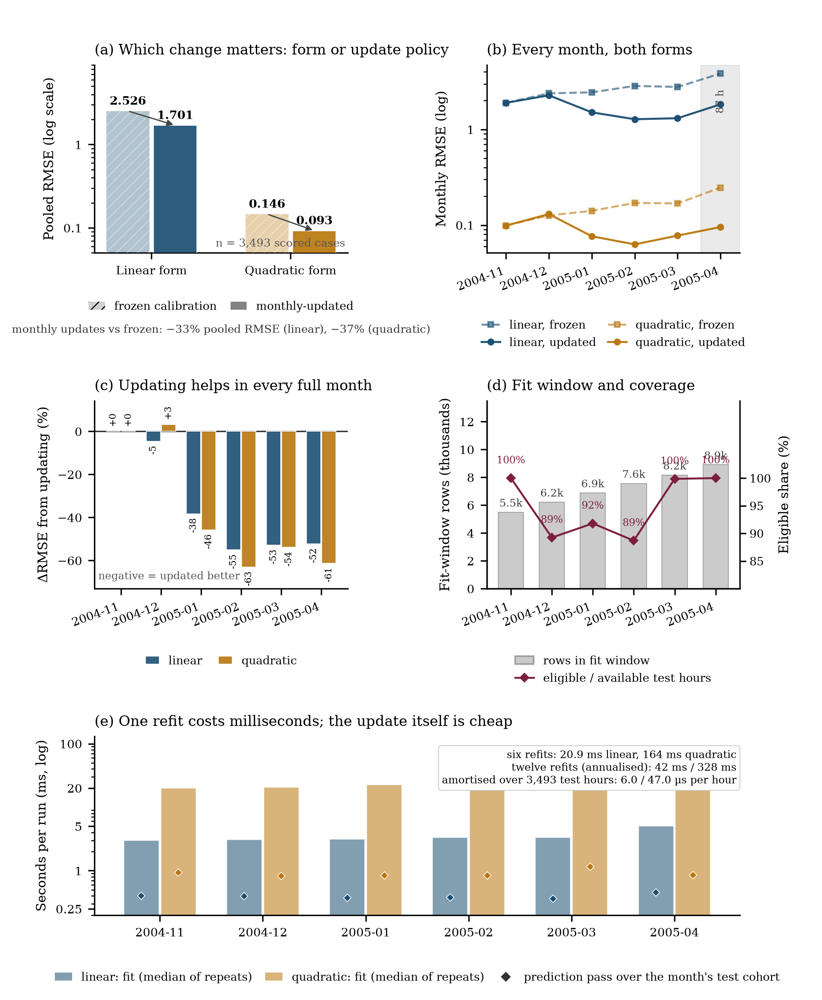
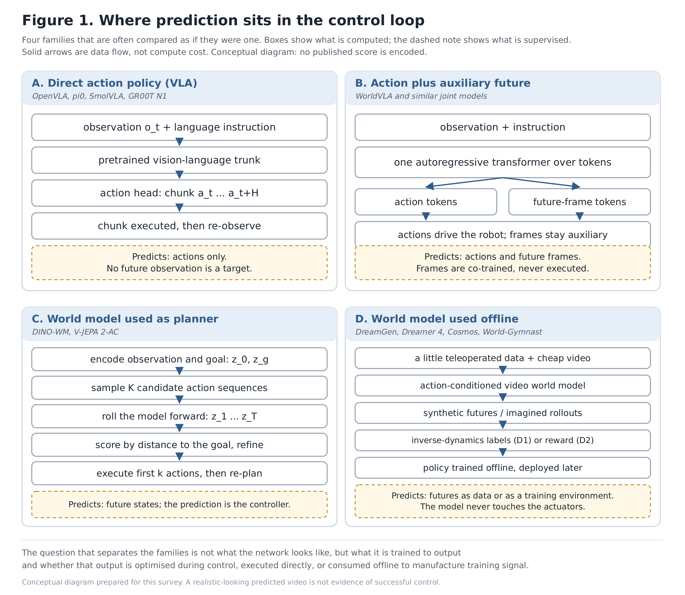
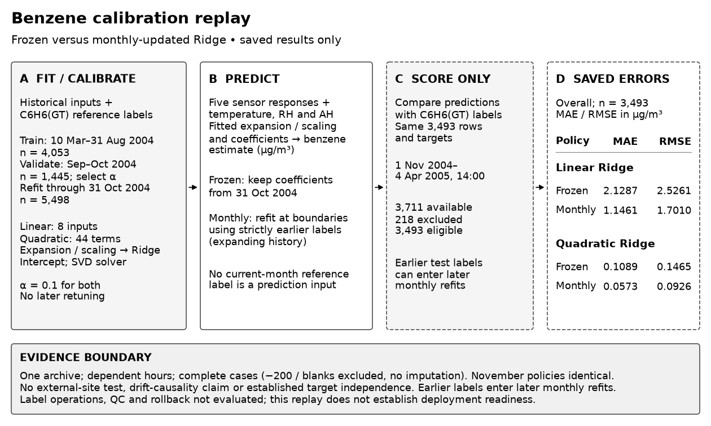
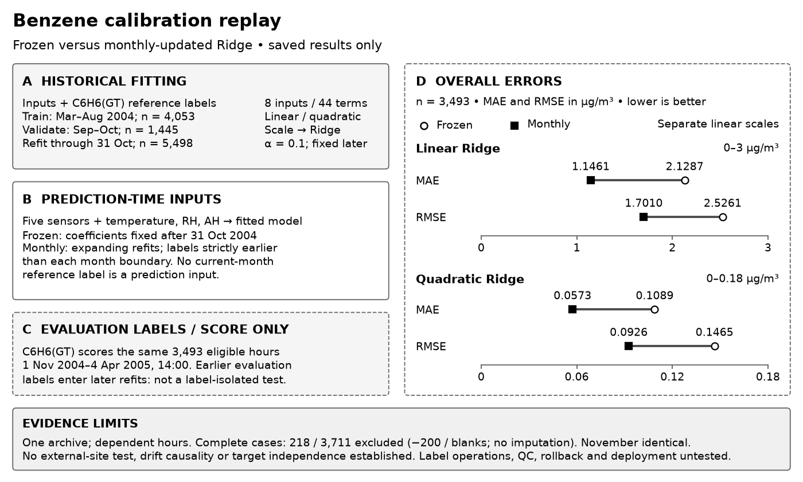

# 用真实成果了解项目

[English](README.md) · [开始使用](../USAGE_zh.md) · [效果证据与限制](../EVALUATION_zh.md)

这里的正文、图形和源码由框架任务生成；维护者没有代写科学成果。人参与了目标说明、执行授权、缺陷反馈、环境准备和独立检查。开发过程中也修改过框架、显式续接过任务，因此这些不是一次运行的成功率或成本承诺。

## 保存结果：分析、改图、报告

**需求：** 利用已有结果比较模型形式、月度更新、数据覆盖与计算开销，不重做实验。

**交付：** 六页 PDF、五面板图、四张表、冻结输入、绘图源码与可编辑 TeX。反馈修正了计时汇总、图形标签和不受输入支持的应用解释。

[阅读报告](../../examples/saved-results-report/report/report.pdf) · [复跑图表与重建 PDF](../../examples/saved-results-report/README_zh.md) · [文件来源和哈希](../../examples/saved-results-report/provenance.json)

独立核查覆盖 72 项数值条件和搬迁重建，最终六页另经逐页查看。结论仅适用于保存结果：没有区间估计，计时来自一台机器，年度开销是折算情景，输入没有确立物理领域与目标单位。原生状态仍为 `partial`。

## 机器人：从方向到技术调研

**需求：** 比较 VLA 与世界模型如何预测、如何进入控制，以及不同路线的证据范围。

**交付：** 十页 PDF、16 项引用、两张说明图、两张表、中文简报和可编辑 Markdown/LaTeX。图形是机制与证据关系说明，不是虚构的跨论文性能排名。

[阅读报告](../../examples/robotics-survey/report/survey.pdf) · [中文简报](../../examples/robotics-survey/report/briefing_zh.md) · [重建方法与源码](../../examples/robotics-survey/README_zh.md) · [文件来源和哈希](../../examples/robotics-survey/provenance.json)

这不是全面的 2026 年综述：选集主要来自 2024–2025 年，仅两篇来自 2026 年；部分全文没有被充分采用，部分作者信息未核实。最终报告完成独立逐页查看及搬迁编译，但没有完整自动视觉签收。原生状态仍为 `partial`。

## 横版比较图：当前可复跑导出

这个较早案例适合作为无需密钥的第一次体验：保留八个数值、单位和两类模型的尺度，把文字为主的结果改成配对视觉比较。

| 初版 | 反馈后 |
| --- | --- |
|  |  |

[复制命令，直接复跑](../../examples/figure-feedback/README_zh.md)。生成版本为 `f45b596`；独立核查八值与冻结数据，同环境搬迁后的两张 PNG 字节一致。没有重新拟合模型，原生 `partial` 与图注措辞限制保留。

## 人工参与、版本和成本

两份新案例最终交付在与 `d3b0721` 等价的代码上检查，相关修复包含在 main。全部公开科学文件均是所选交付文件的逐字节副本；教程由维护者编写。完整对话、账本、旧失败和论文全文不随仓库公开。

| 案例 | 已结算物理请求 | 已结算 tokens | 统计范围 |
| --- | ---: | ---: | --- |
| 保存结果分析报告 | 180 | 5,871,880 | 全阶段，跨候选、模型连接及多次显式续接 |
| 机器人调研报告 | 164 | 6,086,900 | 全阶段，跨候选、模型连接及多次显式续接 |
| 横版图反馈 | 11 | 211,774 | 单个有界反馈任务；较早失败另记 |

前两项最终写作用官方 `deepseek-flash`、低思考、流式；不是全程只用一个模型。未知用量仍留在原账本，没有当作零或释放。这些数字是开发历史，不是一次普通用户任务的费用，也不是金额账单。**离线复跑不调用模型；重新生成会产生新费用，结果与成本不保证相同。**

## 较早成果

以下结果保留原版本背景，不改称最新候选重新生成：

- **UCI Bike Sharing：** [四页 ACM 报告](assets/bike-sharing-report.pdf)及[六面板图](assets/bike-sharing-revised.png)。使用 731 条日观测，反馈拆解组内变化和构成变化；732 个表格单元格独立复算无差异。任务跨开发候选，63 次物理请求、2,027,970 已结算 tokens，另留 127,644 未知预留。不是因果研究或单额度成功。
- **方法图反馈：** [初稿](assets/study-figure-before.png)与[单栏灰度版本](assets/study-figure-after.png)。复用已有空气质量校准结果，不开展新实验；34 次请求、864,326 已结算 tokens，五笔未知预留保留。初稿存在布局问题，不能当作通过验收。
- [历史展示文件校验值](artifacts.json)只对应这些较早导出；新案例各有独立 `provenance.json`，不能混用版本。

Bike Sharing 来源为 [UCI](https://doi.org/10.24432/C5W894)；较早空气质量结果来源为 [UCI Air Quality](https://doi.org/10.24432/C59K5F)。重用前核对上游条款。项目许可证仍未确定，本页不额外授予第三方材料权利。

想使用自己的文件，请从[入门教程](../USAGE_zh.md)开始；想了解哪些能力仍不稳定，请读[效果证据与限制](../EVALUATION_zh.md)。
