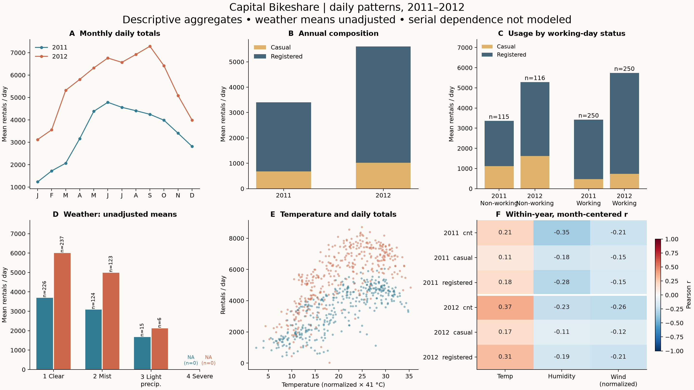
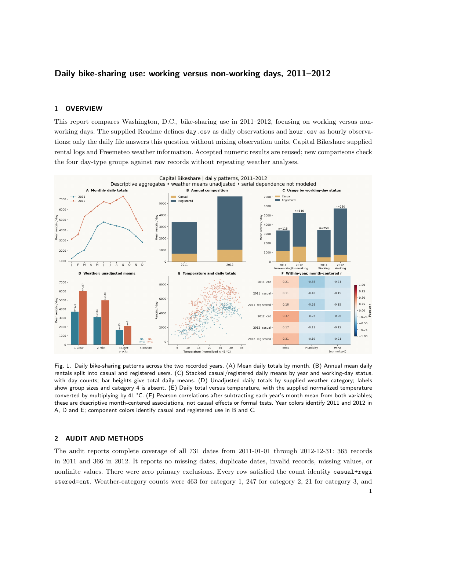
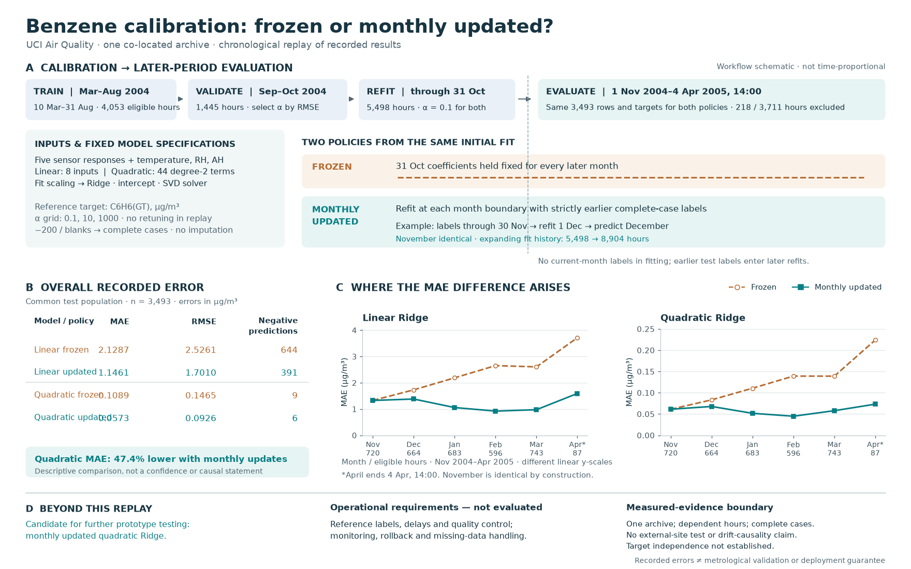
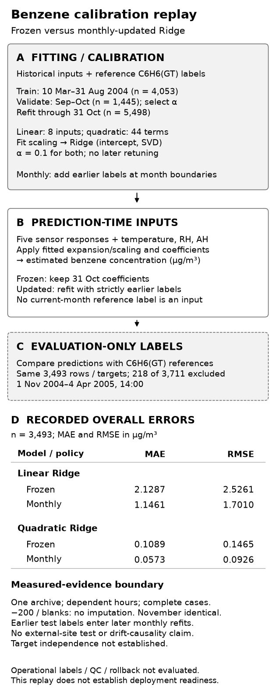

# 实际交付成果

[English](README.md) · [项目首页](../../README_zh.md)

这里展示的是 SimpleAutoResearch 在开发验收期间，经原生任务与反馈路径生成的成果，不是 benchmark 成绩，也不承诺无人干预的一次成功。人提供目标、授权和独立检查；过程中存在框架修正与追加的有界预算。人工撰写的 RSI 报告没有作为框架成果放在这里。

## Bike Sharing：从数据观察到反馈后的报告

**用户任务。** 分析公开的 [UCI Bike Sharing 数据集](https://doi.org/10.24432/C5W894)，解释规律和局限，交付可复跑分析、图形与报告。输入包含日表、小时表及说明；实际分析采用 2011–2012 年的 731 条日观测，没有混合日表和小时表。

**反馈要求。** 按工作日状态拆解年度比较，区分组内变化与日期构成变化，保留原先已接受的表格。

**实际交付。** 框架生成了分析代码、数值表、修订图形、正文及 ACM 导出。本页公开图形和[四页 PDF](assets/bike-sharing-report.pdf)；原验收包另保存了脚本、数据引用和重建材料。

独立检查复算了 732 个表格单元格，未发现差异，并核查了搬迁重建。保存的内容审查记录未对规范正文进行人工重写。这些检查支持本项成果，不代表任意分析任务都可靠。

**仍然存在的不足。** 这是观察数据的描述性分析，不是因果证明，也不是独立重复实验。图形标签偏密，代码和表头断行不够自然，末页偏空。编译成功不能当作科学质量评分。

**成本与版本背景。** 保存的运行记录包含 63 次物理模型请求、2,027,970 个已结算 tokens、40 次进程调用（含编译）；另有五笔未知用量预留，共 127,644 tokens，未释放或混同为已结算消耗。原 40 次/1.6M tokens 合同不足，之后记录了四份有界授权。任务经历 r1–r3 开发候选，出版阶段修正过图注归属。因此不能宣称它在单一冻结版本、原始预算内一次完成。

## 科研方法图：不重做实验的反馈修改

**用户任务。** 将已有空气质量校准结果整理为可编辑说明图，再按反馈改成单栏、灰度友好的版本，区分拟合、预测与评价。

| 初稿 | 反馈版本 |
| --- | --- |
|  |  |

初稿存在布局冲突，视觉检查还遇到服务失败，不能算通过验收的最终成果。反馈版本调整布局与信息层次，使用的仍是已有测量；没有重新训练、开展新实验或证明外部站点适用性。

原任务交付了可编辑绘图源码和导出文件。独立审查记录了两次搬迁绘图重建，栅格结果逐字节一致，132 份原文件未改变。本页公开前后两张 PNG，不包含完整执行归档。

记录包含 34 次模型请求、864,326 个已结算 tokens 和四次进程执行；账本仍保留五笔未知用量预留。目标、执行授权及审查由人提供。

## 来源与使用说明

公开文件是保存成果的逐字节副本，没有为宣传重新绘制。[文件校验值与来源标识](artifacts.json)记录了任务和版本。来源标识对应开发工作区的相对路径；这些被忽略的运行归档不随代码仓库发布。

Bike Sharing 数据归属 UCI 及 Fanaee-T、Gama 的论文 *Event labeling combining ensemble detectors and background knowledge*，见[论文 DOI](https://doi.org/10.1007/s13748-013-0040-3)。再利用前请核对上游数据条款。本页用于展示结果，不是完整复现包，也不是 V2.9 已全部完成的证明。

尝试自己的任务请看[入门](../USAGE_zh.md)和[任务指南](../WORKFLOWS_zh.md)。实际成本、迭代次数与质量取决于任务和服务。
