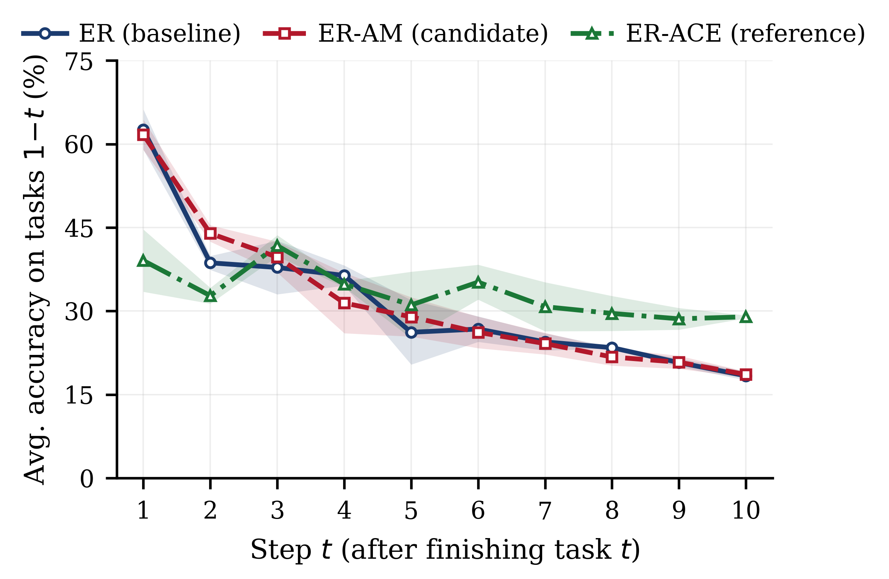
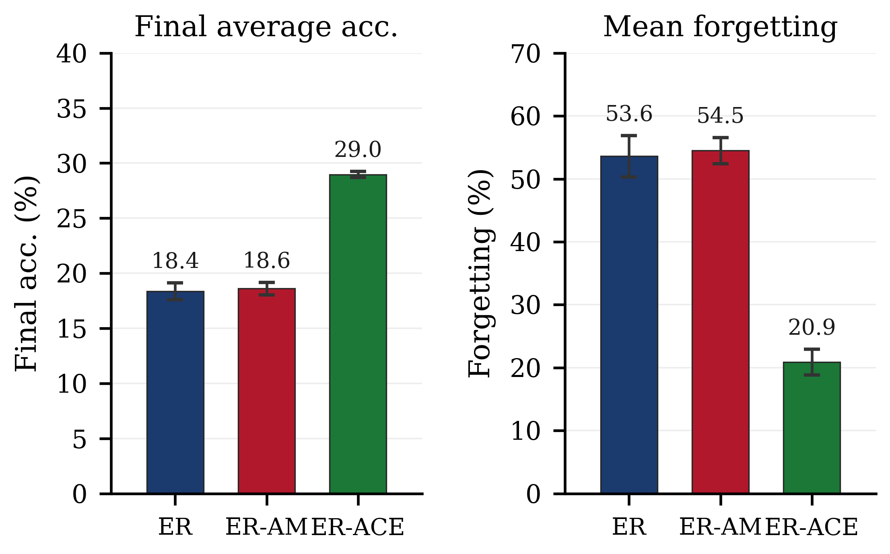
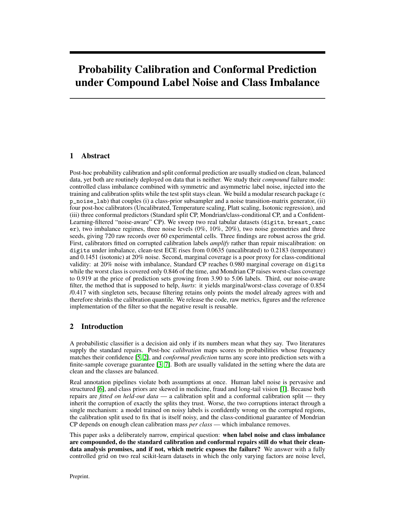
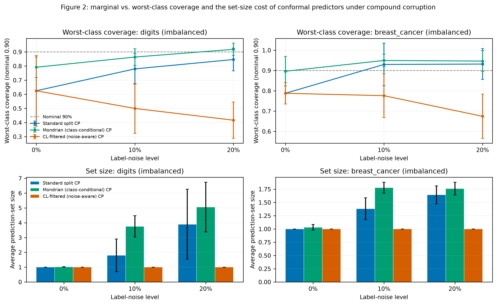
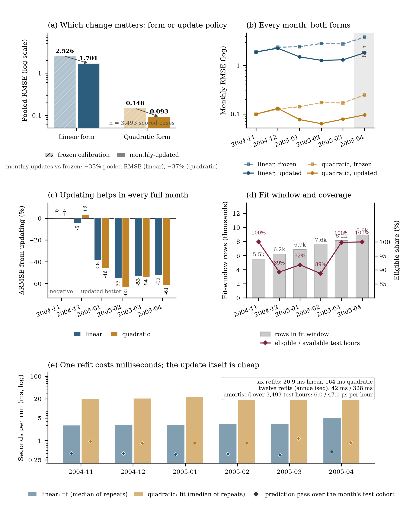
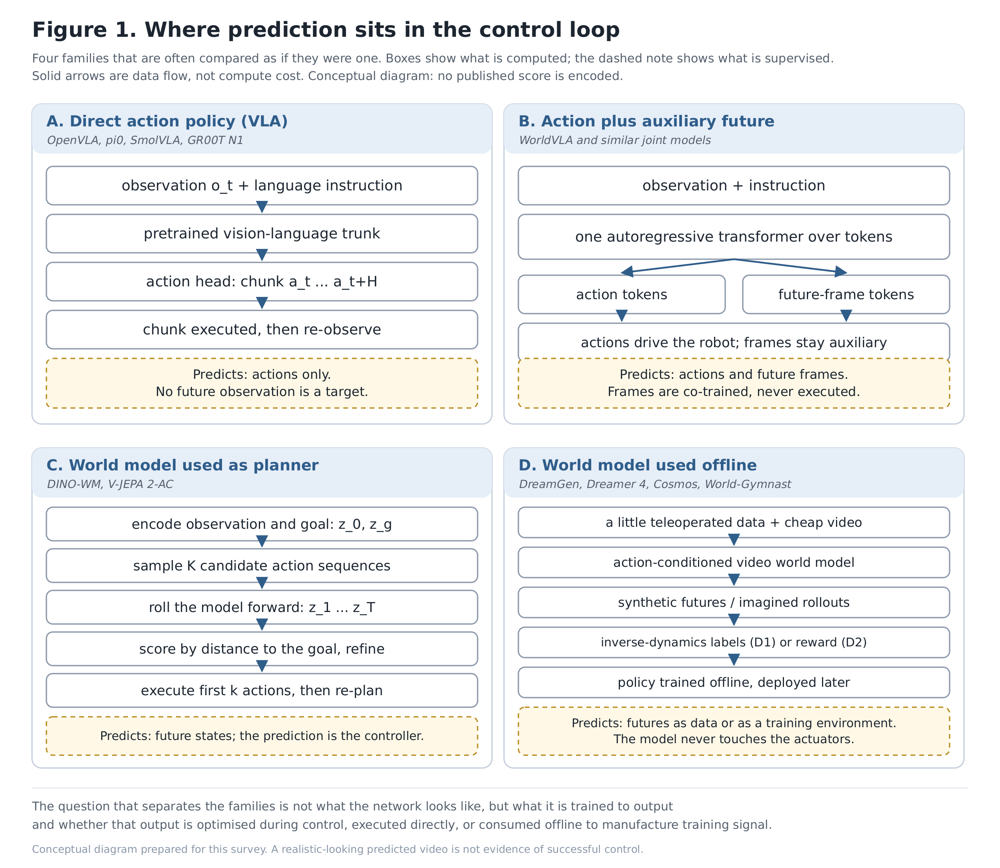
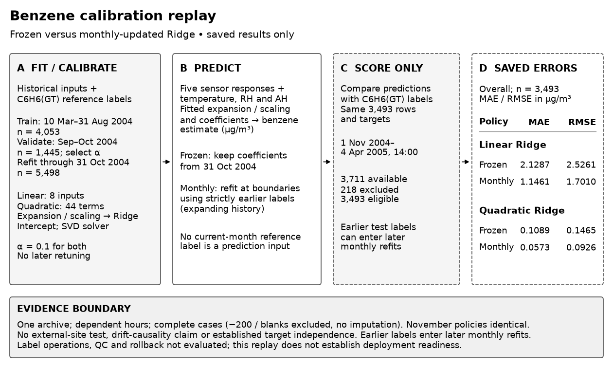
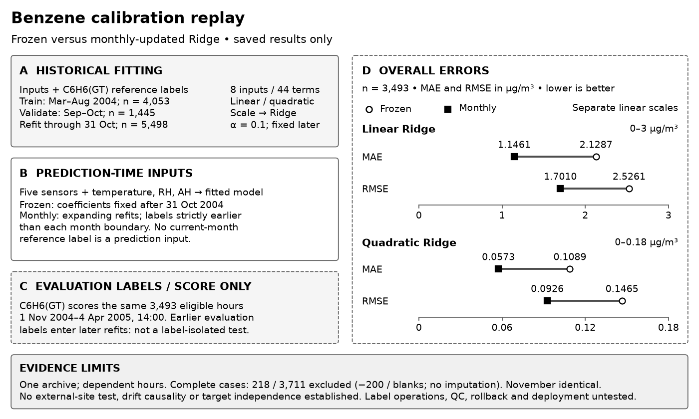

# 用真实成果了解项目

[English](README.md) · [开始使用](../USAGE_zh.md) · [文档导航](../README_zh.md)

这里展示框架任务生成的正文、图形和源码，并提供阅读与复跑入口。运行中，人提供目标、执行授权、缺陷反馈、环境准备和独立检查。部分任务经历过框架修复与显式续接，因此案例同时说明人工参与、成本与未完成部分。

## 单卡 RTX 3090 真实 GPU 持续学习研究（Mammoth / Split CIFAR-100）

**需求：** 在单张 RTX 3090 上仅挂载干净的 `aimagelab/mammoth` 只读代码库（不预下载数据集、不预设改进算法），要求框架自主探测环境与获取 CIFAR-100、联网检索持续学习文献、定位源码设计并实现候选方法、在 `seq-cifar100`（10 个增量任务）上完成 3 种子基线/候选严格对照实验、绘制出版级图表并撰写完整论文草稿，再在二期会话中通过 `--from-session --auto-approve-execution --allow-vision` 自动审修全部图表。

**交付与实测结果：**
- **主研究会话（RTX 3090，89 次请求 / 434.4 万 tokens / 累计进程耗时 36.6 分钟，含 3 次 `--authorize-remaining` 断点无重跑续接）**：自主定位本机 `/root/autodl-pub/cifar-100` 并校验、修补 `mammoth/datasets/__init__.py` 兼容问题、完成 14 次 arXiv/OpenAlex 文献检索，设计单变量候选方法 **ER-AM**（仅对当前任务行屏蔽未见类 logit）。经 1-epoch 冒烟标定后完成 3 种子 `ER`（18.38 ± 0.77%，遗忘 53.59%）与 `ER-AM`（18.61 ± 0.57%，配对差 +0.23 pp，*t* = 0.30）训练，并**主动追加 3 种子 `ER-ACE` 参照消融**（28.97 ± 0.27%，遗忘 20.88%，+10.60 pp，*t* = 17.9），诚实报告受控负结果与机制归因。独立审查器自行编写 `verify_numbers.py` 复算全部指标并核验 CUDA/PyTorch 版本后签收交付（`version=1`，26 项产物，规范 Markdown 稿件，无 Pandoc/LaTeX 环境未编 PDF）。
- **二期零审批视觉审修会话（`--from-session ... --reuse artifacts --auto-approve-execution --allow-vision`）**：复用主会话产物，调用视觉路由自动诊断并消除 `fig1` y 轴截断、`fig2` 标题/标签紧凑与 `fig3` 图例碰柱等全部排版瑕疵，全程 0 次人工审批中断。

| 10 任务增量平均准确率曲线（v2 视觉审修后） | 最终平均准确率与平均遗忘率对比（v2 视觉审修后） |
| --- | --- |
|  |  |

## 机器学习顶会论文闭环 + 跨数据集复用（NeurIPS 2025 模板）

**需求：** 围绕“类别不平衡与标签噪声双重污染下的概率校准与共形预测”，仅挂载一份官方 `neurips_2025.sty` 模板，要求自主联网检索文献、从零编写模块化实验代码库、在多个真实表格数据集上开展受控实验、绘制出版级英文图表、编译 NeurIPS 2025 英文 PDF 并沉淀可迁移方法手册 `SKILL.md`；随后在新会话中通过 `--from-session ... --reuse artifacts` 将方法迁移至全新 `wine` 三分类数据集。

**交付与实测结果：**
- **主研究会话（全程零人工干预，Linux `bwrap` 沙箱，70 次调用 / 333.6 万 tokens）**：联网生成 8 篇可核验 DOI 的 `references.bib`，写出 7 模块 `cp_noise_lab/` 代码库，在 `digits` 与 `breast_cancer` 上完成 60 组配置 = 720 条实验记录，产出 3 张英文图与 9 页官方 NeurIPS 2025 英文 PDF（共 35 项文件）。独立复核抓出了 `SKILL.md` 的 2 处接口漂移（主代理当场重写修正）与正文 1 处过强表述，因 70 次调用上限到达未重编 PDF，系统诚实落盘为 `partial` 并列出 3 条精确 `unresolved`。
- **跨数据集复用会话（`--from-session ... --reuse artifacts`，61 次调用 / 283.2 万 tokens）**：成功承接 `cp_noise_lab/` 与 `SKILL.md`，在全新 `wine` 数据集完成受控对比、绘图与迁移分析报告，独立复核返回 `passed`，正式交付 18 项成果（`status = completed`，`unresolved = []`）。

| 官方 NeurIPS 2025 论文首页（9 页） | 双重污染下最差类覆盖率与集合大小权衡图 |
| --- | --- |
|  |  |

## 保存结果：分析、改图、报告

**需求：** 利用已有结果比较模型形式、月度更新、数据覆盖与计算开销，不重做实验。

**交付：** 六页 PDF、五面板图、四张表、冻结输入、绘图源码与可编辑 TeX。反馈修正了计时汇总、图形标签和不受输入支持的应用解释。

[阅读报告](../../examples/saved-results-report/report/report.pdf) · [复跑图表与重建 PDF](../../examples/saved-results-report/README_zh.md) · [文件来源和哈希](../../examples/saved-results-report/provenance.json)

独立核查覆盖 72 项数值条件和搬迁重建，最终六页另经逐页查看。结论仅适用于保存结果：没有区间估计，计时来自一台机器，年度开销是折算情景，输入没有确立物理领域与目标单位。原生状态仍为 `partial`。

## 机器人：从方向到技术调研

**需求：** 比较 VLA 与世界模型如何预测、如何进入控制，以及不同路线的证据范围。

**交付：** 十页 PDF、16 项引用、两张说明图、两张表、中文简报和可编辑 Markdown/LaTeX。图形是机制与证据关系说明，不是虚构的跨论文性能排名。

[阅读报告](../../examples/robotics-survey/report/survey.pdf) · [中文简报](../../examples/robotics-survey/report/briefing_zh.md) · [重建方法与源码](../../examples/robotics-survey/README_zh.md) · [文件来源和哈希](../../examples/robotics-survey/provenance.json)

这不是全面的 2026 年综述：选集主要来自 2024–2025 年，仅两篇来自 2026 年；部分全文没有被充分采用，部分作者信息未核实。最终报告完成独立逐页查看及搬迁编译，但没有完整自动视觉签收。原生状态仍为 `partial`。

## 横版比较图：当前可复跑导出

这个较早案例适合作为无需密钥的第一次体验：保留八个数值、单位和两类模型的尺度，把文字为主的结果改成配对视觉比较。

| 初版 | 反馈后 |
| --- | --- |
|  |  |

[复制命令，直接复跑](../../examples/figure-feedback/README_zh.md)。生成版本为 `f45b596`；独立核查八值与冻结数据，同环境搬迁后的两张 PNG 字节一致。没有重新拟合模型，原生 `partial` 与图注措辞限制保留。

## 人工参与、版本和成本

两份新案例最终交付在与 `d3b0721` 等价的代码上检查，相关修复包含在 main。全部公开科学文件均是所选交付文件的逐字节副本；教程由维护者编写。完整对话、账本、旧失败和论文全文不随仓库公开。

| 案例 | 已结算物理请求 | 已结算 tokens | 统计范围 |
| --- | ---: | ---: | --- |
| 保存结果分析报告 | 180 | 5,871,880 | 全阶段，跨候选、模型连接及多次显式续接 |
| 机器人调研报告 | 164 | 6,086,900 | 全阶段，跨候选、模型连接及多次显式续接 |
| 横版图反馈 | 11 | 211,774 | 单个有界反馈任务；较早失败另记 |

前两项最终写作用官方 `deepseek-flash`、低思考、流式；不是全程只用一个模型。未知用量仍留在原账本，没有当作零或释放。这些数字是开发历史，不是一次普通用户任务的费用，也不是金额账单。**离线复跑不调用模型；重新生成会产生新费用，结果与成本不保证相同。**

## 较早成果

以下结果保留原版本背景，不改称最新候选重新生成：

- **UCI Bike Sharing：** [四页 ACM 报告](assets/bike-sharing-report.pdf)及[六面板图](assets/bike-sharing-revised.png)。使用 731 条日观测，反馈拆解组内变化和构成变化；732 个表格单元格独立复算无差异。任务跨开发候选，63 次物理请求、2,027,970 已结算 tokens，另留 127,644 未知预留。不是因果研究或单额度成功。
- **方法图反馈：** [初稿](assets/study-figure-before.png)与[单栏灰度版本](assets/study-figure-after.png)。复用已有空气质量校准结果，不开展新实验；34 次请求、864,326 已结算 tokens，五笔未知预留保留。初稿存在布局问题，不能当作通过验收。
- [历史展示文件校验值](artifacts.json)只对应这些较早导出；新案例各有独立 `provenance.json`，不能混用版本。

Bike Sharing 来源为 [UCI](https://doi.org/10.24432/C5W894)；较早空气质量结果来源为 [UCI Air Quality](https://doi.org/10.24432/C59K5F)。重用前核对上游条款。项目许可证仍未确定，本页不额外授予第三方材料权利。

## 适用范围与当前限制

- 可优先尝试已有数据分析、Python 代码工作和有材料依据的报告。长篇开放调研、复杂环境准备及自主复现仍需要审阅和人工参与。
- 长任务和图文反馈可能暂停或部分完成；当前还不能保证无人干预地从初稿完成全部修改和交付。已保存成果不等于本次反馈已经通过。
- 默认任务额度不是长报告的足额保证。先缩小目标、审阅初稿并留出反馈空间，再决定是否继续；模型和服务商决定实际金额。
- 保存图表可离线复跑，报告可从已交付源码重建；这些不等于重新进行了检索、写作或模型生成。
- 提供的可信模板可以用于转换；自主寻找模板、满足全部会议规则及精细排版仍须逐项核对。工作区隔离不是操作系统沙箱。
- 本页没有当前版本的官方 benchmark 成绩，也不提供跨任务总体成功率。数值检查、编译和可读页面分别证明有限行为，不能代替科学审阅。

使用自己的材料，请从[入门教程](../USAGE_zh.md)开始；按目标找操作方式见[任务指南](../WORKFLOWS_zh.md)。
